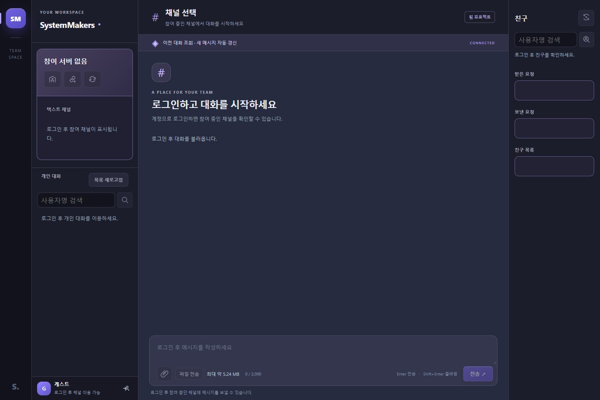
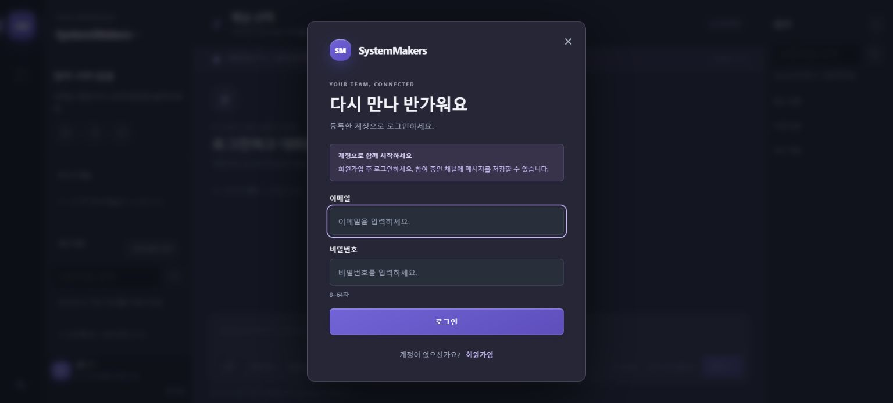
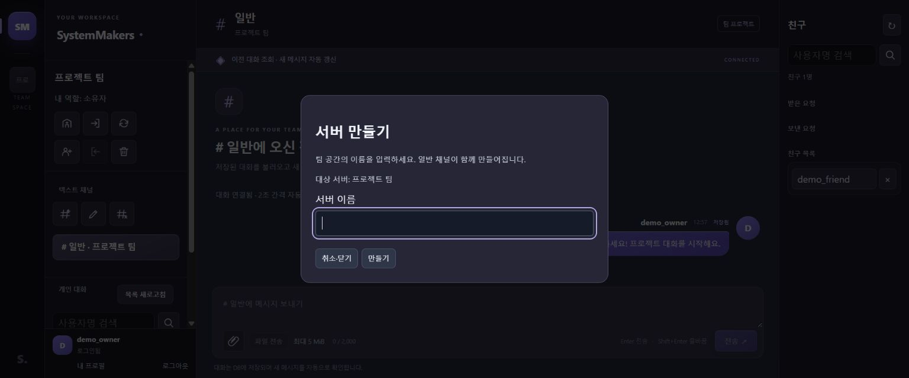
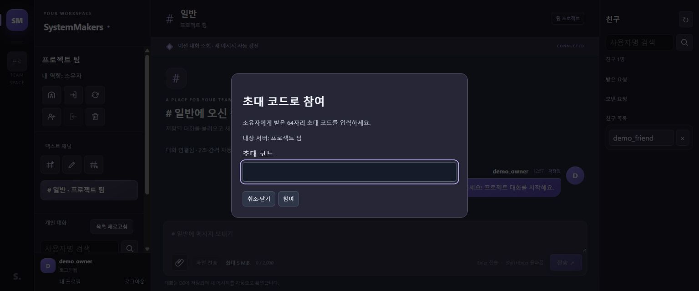
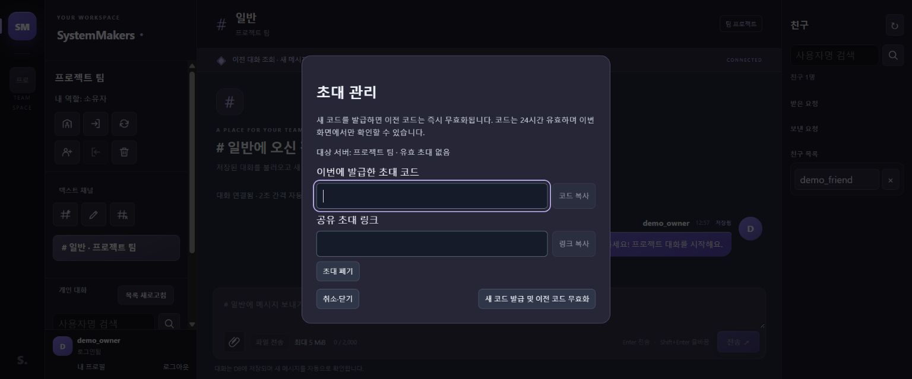
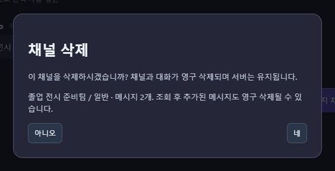
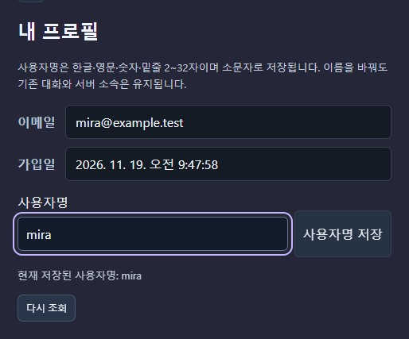
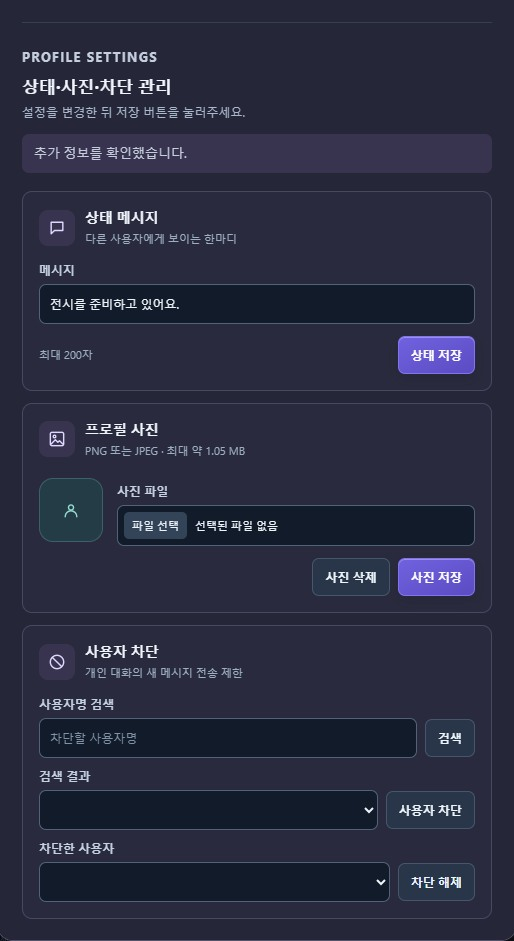
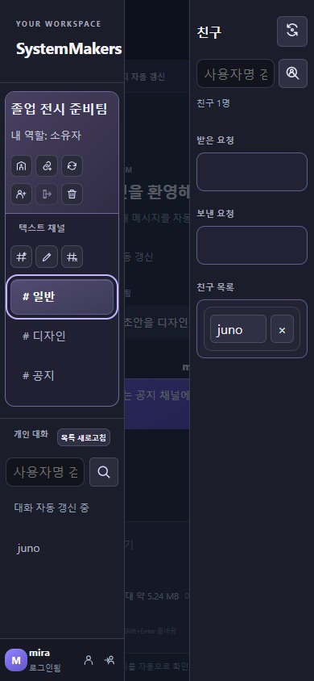

---

# SystemMakers

SystemMakers는 팀별 채널과 1:1 개인 대화에서 메시지와 파일을 주고받는 웹 채팅입니다. 회원가입 후 로그인하고, 서버를 만들거나 초대 코드로 참여하면 그 서버의 채널에서 대화할 수 있습니다.

---

## 실행과 접속

아래 공개 테스트 사이트에서 SystemMakers에 접속할 수 있습니다. [SystemMakers 테스트 사이트 열기](https://projectsys.ddns.net/Team006)

| 접속하는 곳 | 화면을 여는 방법 |
|---|---|
| Windows 서버 PC | 아래 두 서버를 실행한 뒤 [채팅](http://127.0.0.6:8088/Team006/index.html)을 엽니다. 게스트는 [로그인](http://127.0.0.6:8088/Team006/index.html#login-window)과 [회원가입](http://127.0.0.6:8088/Team006/index.html#signup-window) 화면도 바로 열 수 있습니다. |
| 같은 Wi-Fi의 다른 기기 | 웹과 Ratchet을 서버 PC의 Wi-Fi 주소로 실행합니다. 서버 PC에서 `./scripts/show-lan-url.ps1`을 실행해 표시된 웹 주소를 공유합니다. [같은 Wi-Fi 설정](docs/LOCAL-SETUP.md#같은-wi-fi에서-개발용으로-공유) |
| 직접 운영할 NAS | UGREEN DH4300 Plus에 Docker로 배포하고, 다른 Wi-Fi 또는 이동통신망에서 운영용 HTTPS 주소를 확인합니다. [배포와 외부 접속 확인](docs/NAS-DEPLOYMENT.md) |

Windows에서는 PHP 8.3, MySQL 8.4, PHP 확장과 Composer 의존성을 준비합니다. 새 DB에는 기본 스키마와 마이그레이션 001~007을 순서대로 적용합니다. 기존 DB는 먼저 백업하고 미적용 변경을 확인합니다. [개인 설정과 DB 준비](docs/LOCAL-SETUP.md) · [Ratchet 설치](docs/REALTIME.md)

MySQL을 실행한 뒤 저장소 루트에서 PowerShell 창을 두 개 열고 각 창에서 한 줄씩 실행합니다.

```powershell
.\scripts\start-dev.ps1 # 첫 번째 창에서 PHP 웹 서버 시작
.\scripts\start-realtime.ps1 # 두 번째 창에서 Ratchet 알림 서버 시작
```

ZIP 안의 `index.html`을 직접 열면 PHP가 실행되지 않아 로그인과 채팅을 사용할 수 없습니다. 다른 사람이 같은 대화에 참여하려면 서버를 실행한 사람이 공유한 웹 주소를 브라우저에서 열어야 합니다. `127.0.0.6`은 접속하는 기기 자신을 가리킵니다.

---

## 메시지 한 건이 전달되는 과정

1. 보낸 사람의 브라우저가 메시지 본문을 PHP API로 전송합니다. PHP는 세션과 CSRF 토큰을 검사하고, 해당 채널의 서버 소속 또는 개인 대화 참여 권한을 확인한 뒤 MySQL에 저장합니다.
2. 상대방이 같은 대화를 열고 있으면 Ratchet이 새 메시지 ID를 확인하고 WebSocket으로 변경을 알립니다. 상대방의 브라우저는 PHP API에서 본문과 첨부 정보를 조회해 화면에 표시합니다.
3. 실시간 구독 중에도 15초 간격으로 새 기록을 확인합니다. 연결이 끊기면 정상 조회 간격이 2초로 바뀌고, 조회 오류가 계속되면 재시도 간격이 늘어납니다. [실시간 연결과 권한](docs/REALTIME.md)

---

## 기능과 권한

| 기능 | 사용 방법과 권한 |
|---|---|
| 서버와 채널 | 서버 이름을 입력하면 기본 채널 ‘일반’이 만들어집니다. 로그인한 회원이 유효한 초대 링크를 열면 해당 서버로 이동합니다. 게스트는 로그인 후 이어서 참여합니다. 소유자와 관리자가 채널을 관리하고, 소유자가 초대와 서버 삭제를 관리합니다. |
| 개인 대화와 친구 | 왼쪽 서버 목록 맨 위의 사람 아이콘으로 개인 대화를 엽니다. 읽지 않은 대화가 있으면 아이콘과 대화에 `!`가 표시됩니다. 오른쪽 패널에서 받은 요청, 보낸 요청, 친구 목록을 차례로 확인합니다. 차단 시 두 당사자의 신규 전송이 중단됩니다. |
| 메시지와 파일 | 채널과 개인 대화 모두 Enter로 전송하고 Shift+Enter로 줄을 바꿉니다. 텍스트는 최대 2,000자, 테스트용 첨부는 파일당 200 MB입니다. 검증을 통과한 PNG·JPEG·WebP는 채팅 안에서 미리 보고, 모든 첨부에는 원본 다운로드 링크가 표시됩니다. |
| 계정과 프로필 | 사용자명·이메일·비밀번호로 가입하고 이메일로 로그인합니다. 내 프로필에서 사용자명, 상태 메시지, 사진과 차단 목록을 관리합니다. |
| 좁은 화면 | 화면 너비 1050px 이하에서는 ‘친구’ 버튼으로 친구 목록을, 650px 이하에서는 ☰ 버튼으로 채널 목록을 엽니다. 목록 밖을 누르거나 Esc로 닫습니다. |

---

## 코드와 검사

채팅 화면은 어두운 바탕과 보라색 강조를 사용합니다. `index.html`에서 화면 구조를, `frontend/app.css`와 화면별 CSS에서 색상과 배치를 확인할 수 있습니다. [화면별 CSS](docs/UI-DIRECTION.md#색상과-조작-기준)

PHP 요청의 진입점, 메시지 저장·조회, 실시간 구독과 관련 테스트는 [코드 안내](docs/INDEX.md)에 모았습니다. 요청 필드와 오류 응답은 [API 명세](docs/API.md), 테이블 관계와 삭제 규칙은 [DB 구조](docs/DATABASE.md)에서 확인할 수 있습니다.

`main` 푸시와 PR에서는 화면·세션, 백업 실패 시 사본 보존, Linux AMD64·ARM64의 HTTPS·WSS·권한·DB 복원을 검사합니다. 실제 NAS의 인증서, 외부망 양방향 채팅과 휴대폰 검증은 배포 후 확인할 항목입니다. [자동 검사](.github/workflows/docker.yml) · [남은 작업과 최적화 측정 결과](docs/DEVELOPMENT-DIRECTION.md)

---

## 팀 역할

- `신**` — WebSocket·Ratchet과 JavaScript
- `제**` — PHP 백엔드·MySQL·회원 인증·메시지와 파일 API
- `황**` — 로그인과 채팅 화면 등 웹사이트 디자인

---

## 화면 살펴보기

아래 16장은 2026년 11월 19일 테마 변경 전에 촬영한 기능 예시입니다. 최신 색상과 모바일 배치는 실행 중인 화면에서 확인할 수 있습니다. [이미지 ZIP 내려받기](docs/assets/ui/systemmakers-ui-screenshots.zip?raw=true) · [현재 화면 안내](docs/UI-DIRECTION.md)

<details>
<summary>비로그인·로그인·회원가입</summary>

- 비로그인 상태



- 로그인



- 회원가입


</details>

<details>
<summary>채널·개인 대화·친구</summary>

- 왼쪽 배너의 ‘졸업 전시 준비팀’ 아래에 일반·디자인·공지 채널이 묶입니다. 가운데는 선택한 채널의 대화, 오른쪽은 친구 요청과 목록입니다.


- 개인 대화와 파일 선택 영역


- 파일 선택과 전송 전 선택 취소


</details>

<details>
<summary>서버·초대 관리</summary>

- 서버 만들기



- 초대 코드로 참여



- 초대 관리



- 서버 삭제 확인


</details>

<details>
<summary>채널 관리</summary>

- 채널 만들기


- 채널 이름 변경


- 채널 삭제 확인



</details>

<details>
<summary>프로필·상태·사진·차단 관리</summary>

- 내 프로필



- 사진과 사용자 차단 관리



</details>


<details>
<summary>좁은 화면에서 탐색하기</summary>

- 아래 이미지는 이전 배치입니다. 현재 모바일에서는 대화가 화면 전체에 표시됩니다. 상단 왼쪽 메뉴 아이콘은 서버와 채널을, 오른쪽 사람 아이콘은 친구 목록을 엽니다. 한 번에 목록 하나가 열립니다.



</details>
