<hr>

# SystemMakers

SystemMakers는 서버·채널과 1:1 개인 대화에서 메시지와 파일을 주고받는 웹 프로젝트입니다.

- **서버**: 팀이나 모임이 함께 사용하는 공간입니다.
- **채널**: 서버 안에서 주제별로 대화하는 공간입니다.
- **사용 흐름**: 회원가입 → 로그인 → 서버 만들기 또는 초대받기 → 채널 선택 → 대화

화면은 HTML·CSS·JavaScript, 서버는 PHP·MySQL을 사용하며 실시간 알림에는 Ratchet WebSocket을 사용합니다.

- **화면 디자인**: `#262B3F` 배경과 보라색 강조를 사용합니다. 본인 메시지는 오른쪽, 상대방 메시지는 왼쪽에 표시합니다.

- **접속 주소**: [http://127.0.0.6:8088/Team006/index.html](http://127.0.0.6:8088/Team006/index.html)
- **주소 구분**: 웹 브라우저는 위 `127.0.0.6` 주소를 사용합니다. MySQL의 `127.0.0.1`은 별도 DB 연결 주소입니다.
- **화면 자료**: 아래 이미지는 독립된 테스트 DB의 예시 계정과 메시지로 촬영했습니다.
- **이미지 다운로드**: [현재 화면 이미지 15장 받기](docs/assets/ui/systemmakers-ui-screenshots.zip?raw=true)


---

## 화면 살펴보기

<details>
<summary>비로그인·로그인·회원가입</summary>

- 비로그인 상태

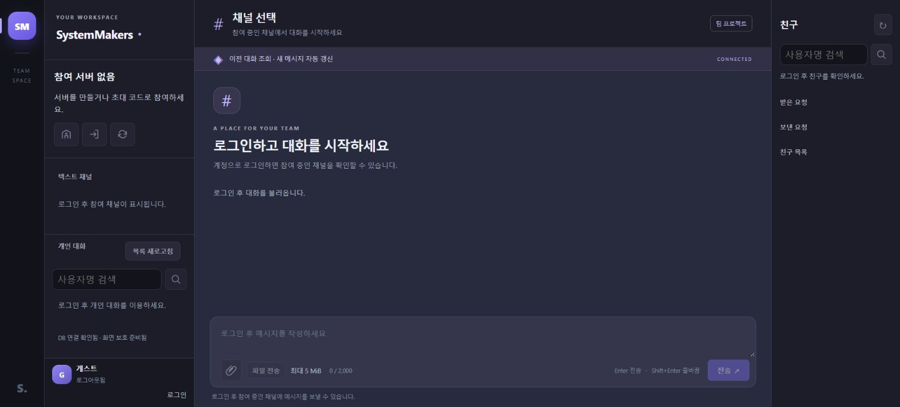

- 로그인

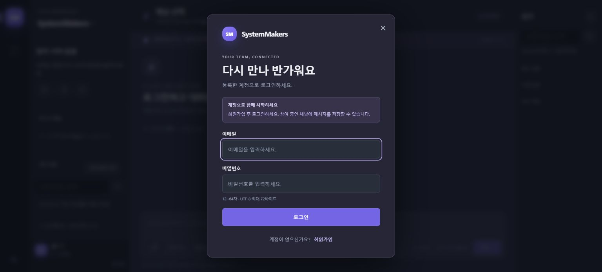

- 회원가입

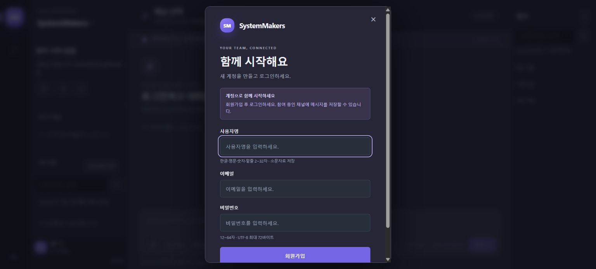

</details>

<details>
<summary>채널·개인 대화·친구</summary>

- 채널 대화와 오른쪽 친구 목록

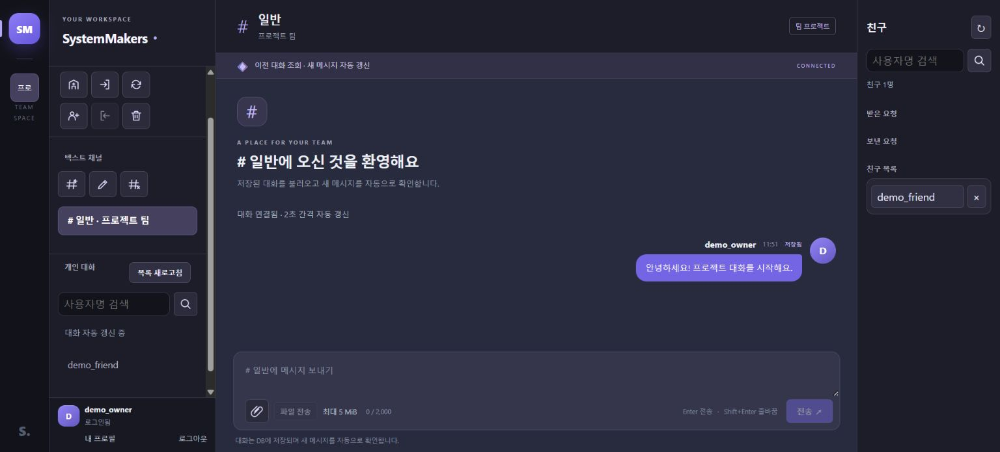

- 개인 대화와 파일 선택 영역

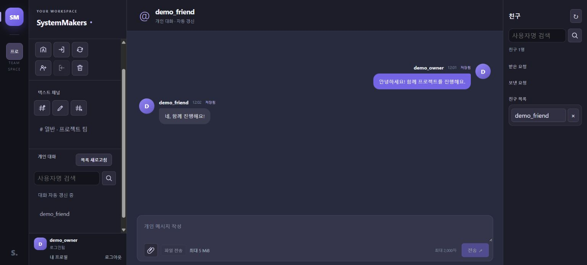

- 파일 선택과 전송 전 선택 취소

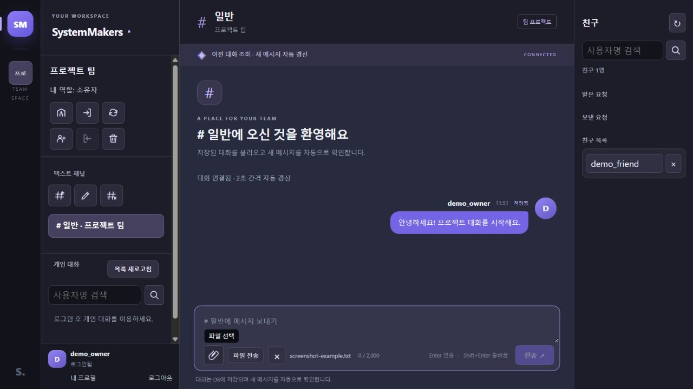

</details>

<details>
<summary>서버·초대 관리</summary>

- 서버 만들기

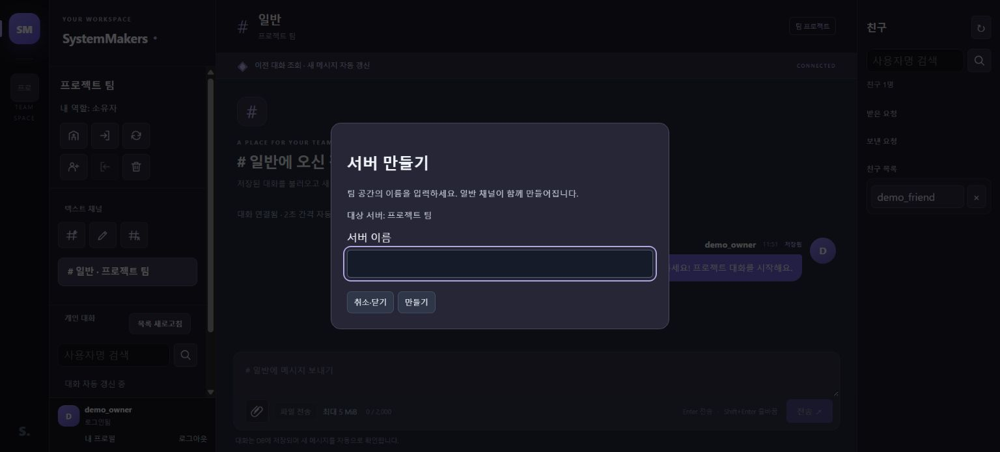

- 초대 코드로 참여

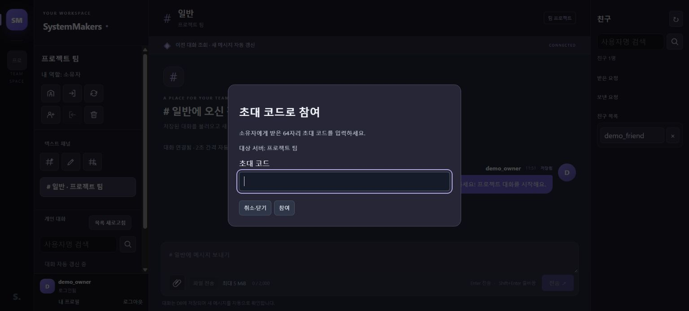

- 초대 관리

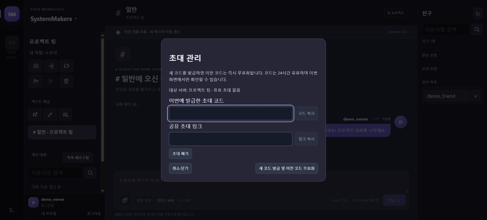

- 서버 삭제 확인

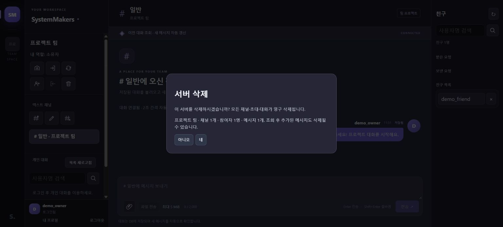

</details>

<details>
<summary>채널 관리</summary>

- 채널 만들기

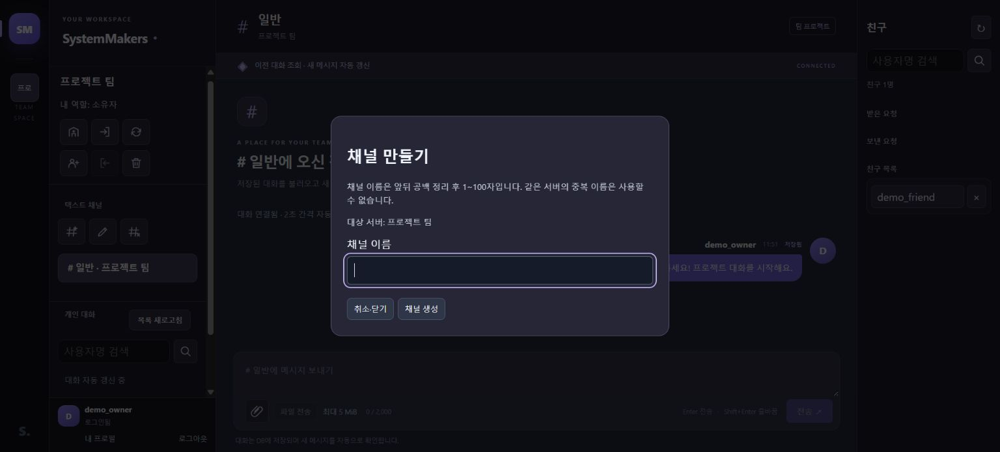

- 채널 이름 변경

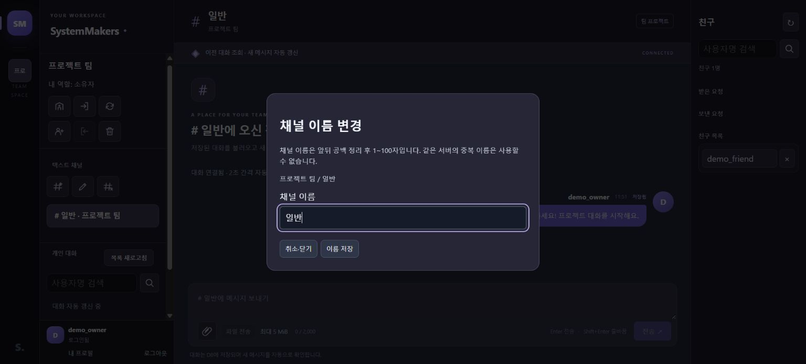

- 채널 삭제 확인

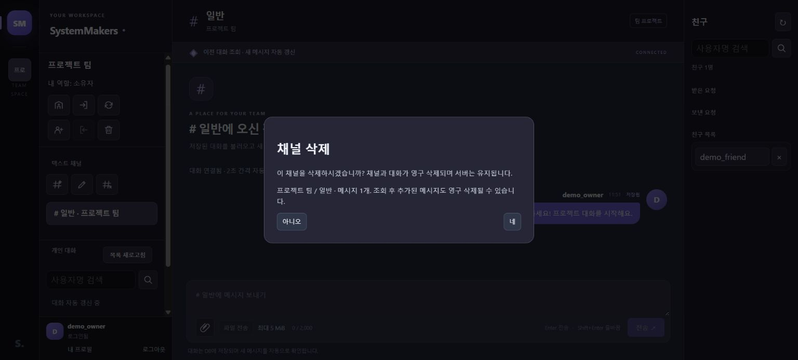

</details>

<details>
<summary>프로필·상태·사진·차단 관리</summary>

- 내 프로필

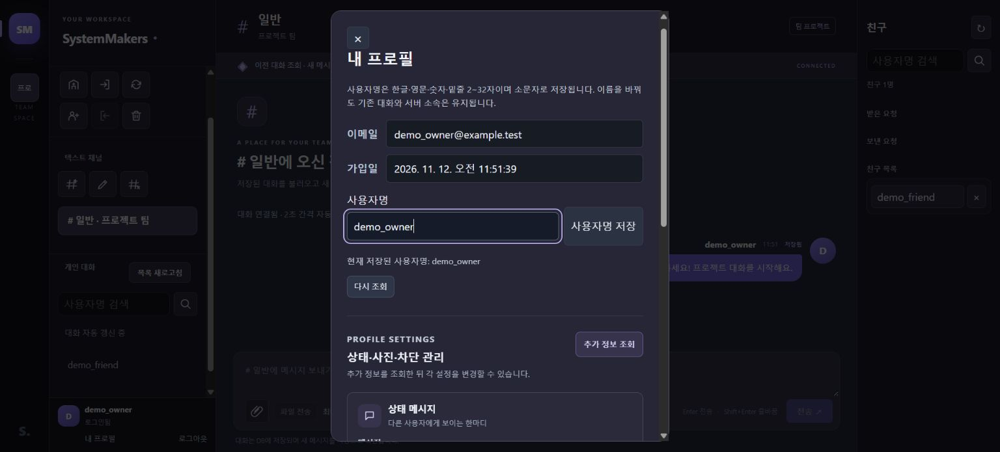

- 사진과 사용자 차단 관리

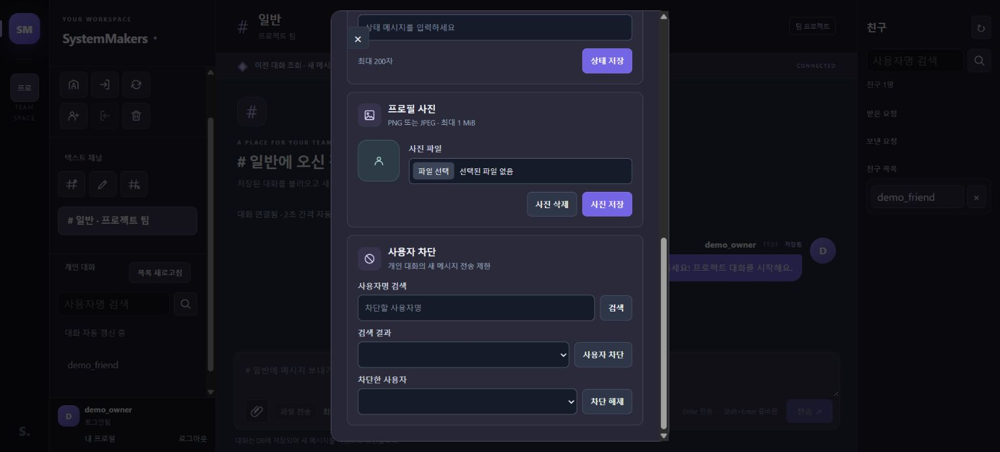

</details>


---

## 주요 기능


---

### 계정과 로그인

- **회원가입**: 사용자명·이메일·비밀번호로 계정을 만듭니다. 사용자명은 한글·영문·숫자·밑줄 2~32자를 지원하며 사용자명과 이메일의 중복을 확인합니다.
  <br>관련 코드·문서: [회원가입](backend/api/register.php) · [계정 검증](backend/includes/accounts.php) · [API 명세](docs/API.md)

- **로그인·로그아웃**: 이메일과 비밀번호로 로그인하고 사용을 마치면 로그아웃합니다. 가입 후에는 별도로 로그인해야 합니다.
  <br>관련 코드·문서: [로그인](backend/api/login.php) · [로그아웃](backend/api/logout.php) · [API 명세](docs/API.md)

- **로그인 상태 확인**: 페이지를 새로고침하면 유효한 로그인 상태를 확인합니다.
  <br>관련 코드·문서: [현재 사용자 조회](backend/api/get_current_user.php) · [화면 처리](frontend/app.js)

- **로그인 시도 제한**: 이메일과 IP별로 지나치게 많은 로그인 시도를 제한합니다. 비밀번호는 해시로 저장합니다.
  <br>관련 코드·문서: [로그인 제한](backend/includes/login_rate_limit.php) · [API 명세](docs/API.md)


---

### 서버와 초대

- **서버 생성**: 팀 공간을 만듭니다. 생성자는 소유자가 되고 기본 채널이 함께 만들어집니다.
  <br>관련 코드·문서: [서버 생성](backend/api/create_server.php) · [서버 관리](backend/includes/server_management.php)

- **서버 목록·선택**: 내가 참여 중인 서버를 확인하고 선택합니다.
  <br>관련 코드·문서: [서버 목록](backend/api/list_servers.php) · [화면 상태](frontend/server-manager.mjs)

- **초대 발급·폐기**: 소유자가 초대 코드를 발급·복사·재발급·폐기합니다. 코드는 발급 후 24시간 유효합니다.
  <br>관련 코드·문서: [초대 발급](backend/api/create_server_invite.php) · [초대 폐기](backend/api/revoke_server_invite.php) · [API 명세](docs/API.md)

- **초대 참여·탈퇴**: 초대 코드로 서버에 참여합니다. 소유자가 아닌 회원은 탈퇴할 수 있으며, 작성한 대화는 남습니다.
  <br>관련 코드·문서: [서버 참여](backend/api/join_server.php) · [서버 탈퇴](backend/api/leave_server.php)

- **초대 링크**: 발급한 초대 링크를 복사하고 상대방은 참여 여부를 직접 확인합니다.
  <br>관련 코드·문서: [초대 화면](frontend/server-ui.mjs)

- **서버 삭제**: 소유자가 대상과 삭제 영향을 확인한 뒤 네·아니오로 선택합니다. 소속·채널·대화도 함께 삭제됩니다.
  <br>관련 코드·문서: [삭제 미리보기](backend/api/get_deletion_preview.php) · [서버 삭제](backend/api/delete_server.php)


초대 관리 창의 **새 코드 발급 및 이전 코드 무효화** 버튼을 누르면 이전 코드가 무효화되고 새 코드가 발급됩니다. 코드와 링크는 각 입력칸 옆 버튼으로 복사할 수 있습니다.


---

### 채널

- **채널 조회**: 참여한 서버의 주제별 채널을 확인하고 대화할 채널을 선택합니다.
  <br>관련 코드·문서: [채널 목록](backend/api/get_channels.php) · [채널 화면](frontend/channel-ui.mjs)

- **채널 생성·이름 변경**: 소유자와 관리자가 채널을 만들고 이름을 바꿉니다. 이름을 변경해도 기존 대화는 유지됩니다.
  <br>관련 코드·문서: [채널 생성](backend/api/create_channel.php) · [이름 변경](backend/api/update_channel.php)

- **채널 삭제**: 소유자와 관리자가 삭제 대상과 메시지 수를 확인한 뒤 네·아니오로 선택합니다.
  <br>관련 코드·문서: [삭제 미리보기](backend/api/get_deletion_preview.php) · [채널 삭제](backend/api/delete_channel.php)

- **역할별 접근**: 일반 회원은 소속 채널에서 대화하고, 소유자와 관리자는 채널을 관리합니다.
  <br>관련 코드·문서: [접근 권한](backend/includes/permissions.php) · [역할 규칙](docs/PHASE-7-RULES.md)


서버·채널 관리 버튼은 벡터 아이콘으로 표시합니다. 마우스를 올리거나 키보드로 선택하면 기능 이름이 나타납니다.

왼쪽의 서버·채널·개인 대화 목록은 스크롤할 수 있고 서비스 제목과 사용자 정보는 각각 상단과 하단에 고정됩니다. 수락된 친구는 오른쪽 목록에 표시됩니다.

개인 대화와 친구 검색은 돋보기 버튼을 사용하며 마우스와 키보드로 버튼 설명을 확인할 수 있습니다.

---

### 메시지와 대화

- **텍스트 메시지**: 한글·이모지·줄바꿈을 포함해 최대 2,000자까지 전송하고 대화를 저장합니다.
  <br>관련 코드·문서: [메시지 전송](backend/api/send_message.php) · [메시지 처리](backend/includes/messages.php)

- **입력과 전송**: Enter로 메시지를 전송하고 Shift+Enter로 줄을 바꿉니다.
  <br>관련 코드·문서: [화면](index.html) · [입력 처리](frontend/app.js)

- **최근·이전 대화**: 채널의 최근 대화 50개를 불러오고 이전 대화를 추가로 조회합니다.
  <br>관련 코드·문서: [메시지 조회](backend/api/get_messages.php) · [조회 처리](backend/includes/message_history.php)

- **새 메시지 확인**: WebSocket 알림을 받으면 새 메시지를 조회하고, HTTP 주기 조회로 누락을 복구합니다.
  <br>관련 코드·문서: [대화 갱신](frontend/message-feed.mjs) · [API 명세](docs/API.md)

- **1:1 개인 대화**: 사용자명을 검색해 개인 대화를 시작하고 이전 기록을 조회합니다.
  <br>관련 코드·문서: [개인 대화](frontend/direct-ui.mjs) · [대화 처리](backend/includes/direct_messages.php)

- **친구 요청과 목록**: 친구 요청을 상대방이 수락하면 오른쪽 패널의 양쪽 친구 목록에 표시하고 대화를 열 수 있습니다.
  <br>관련 코드·문서: [친구 API](backend/api/friends.php) · [친구 화면](frontend/friends-ui.mjs)

- **파일 전송**: 채널과 개인 대화에서 최대 5 MiB 파일을 MySQL에 저장하고 권한 확인 후 다운로드합니다.
  <br>관련 코드·문서: [첨부 저장](backend/api/upload_attachment.php) · [다운로드](backend/api/download_attachment.php)

- **읽는 위치·초안**: 이전 대화를 읽던 위치를 유지하고 채널 이동 시 현재 탭에 작성 중인 내용을 보관합니다.
  <br>관련 코드·문서: [화면 상태](frontend/app.js) · [개발 방향](docs/DEVELOPMENT-DIRECTION.md)

- **오류·재조회**: 대화 조회에 실패하면 다시 연결할 수 있습니다. 전송 결과를 받지 못했을 때 같은 요청을 자동으로 반복하지 않습니다.
  <br>관련 코드·문서: [화면 처리](frontend/app.js) · [대화 갱신](frontend/message-feed.mjs)


새 메시지는 **WebSocket 알림과 HTTP 조회**로 확인합니다. 알림 연결이 끊겨도 HTTP 주기 조회가 유지되며, 네트워크 상태나 브라우저 제한에 따라 반영이 늦어질 수 있습니다. 초안은 현재 탭의 메모리에 보관하므로 새로고침 후 복원되지 않습니다.

파일 선택과 전송 버튼은 채널과 개인 대화의 입력창 왼쪽에 있습니다. 파일을 선택하면 이름과 `×` 버튼이 나타나며, `×`를 누르면 전송 전 선택만 취소됩니다.


---

### 프로필과 접근 보호

- **내 프로필**: 본인의 사용자명·이메일·가입일을 확인하고 사용자명을 변경합니다. 기존 대화와 서버 소속은 유지됩니다.
  <br>관련 코드·문서: [프로필 API](backend/api/profile.php) · [프로필 화면](frontend/profile-ui.mjs)

- **사진·상태 메시지**: 내 상태와 PNG·JPEG 사진을 저장합니다. 사진 처리는 PHP GD 확장이 필요합니다.
  <br>관련 코드·문서: [프로필 상태](backend/api/profile_details.php) · [사진](backend/api/profile_picture.php)

- **사용자 차단**: 한쪽이 차단하면 개인 대화의 양쪽 신규 전송이 중단되고 이전 기록은 유지됩니다.
  <br>관련 코드·문서: [사용자 차단](backend/api/user_blocks.php)

- **접근 권한 확인**: 서버 소속과 관리 권한을 확인해 권한 없는 조회·전송·관리를 차단합니다.
  <br>관련 코드·문서: [권한 확인](backend/includes/permissions.php) · [관리 요청](backend/includes/management_endpoint.php)

- **계정과 요청 보호**: 세션과 CSRF 토큰을 확인하고 다른 탭에서 계정이 바뀌었을 때 잘못된 계정으로 요청하는 일을 방지합니다.
  <br>관련 코드·문서: [세션](backend/includes/session.php) · [CSRF](backend/includes/csrf.php) · [API 명세](docs/API.md)

- **접근 종료 시 정리**: 서버 탈퇴나 채널 삭제가 확인되면 해당 대화·초안·선택 화면을 정리합니다.
  <br>관련 코드·문서: [화면 처리](frontend/app.js) · [검증 결과](docs/PHASE-11-VERIFICATION.md)


인증·서버·채널·프로필 창은 창 바깥을 클릭해 닫을 수 있습니다. 상태 메시지·사진·차단 설정은 각각의 카드에서 관리하며, 저장 결과와 오류도 해당 카드에 표시됩니다. 저장 중에는 결과 확인을 위해 닫기가 잠시 제한됩니다.


---

## 현재 제공하지 않는 기능

- **운영 실시간 연결**: 로컬 WebSocket을 제공하며 운영 환경의 WSS·프록시 설정은 별도 검증이 필요합니다.

- **음성**: 음성 채팅은 제공하지 않습니다.

- **메시지 관리**: 개별 메시지 수정·삭제는 제공하지 않습니다.

- **서버·권한 확장**: 서버 이름 변경, 비공개 채널, 역할 편집, 강퇴, 소유권 이전은 현재 범위 밖입니다.

- **계정 확장**: 이메일·비밀번호 변경, 회원 탈퇴는 제공하지 않습니다.


---

## 로컬 실행

PHP 8.3, MySQL 8.4, Node.js, Composer와 개인 DB 설정이 필요합니다. PHP의 `pdo_mysql`·`mbstring`·`gd` 확장과 DB 초기 설정 방법은 [로컬 실행과 검사](docs/LOCAL-SETUP.md)를 참고하세요.

프로젝트를 `htdocs/Team006/`에 배치하고 저장소 루트에서 다음 명령을 실행합니다.

```powershell
.\scripts\start-dev.ps1 # 로컬 웹 서버 시작
.\scripts\start-realtime.ps1 # 별도 터미널의 실시간 서버 시작
```

접속 주소: [http://127.0.0.6:8088/Team006/index.html](http://127.0.0.6:8088/Team006/index.html)

- 웹 주소는 `-WebHost`, 포트는 `-Port`로 지정합니다. MySQL 주소는 별도의 `MYSQL_HOST` 설정을 사용합니다.
- 자동 검사와 스크린샷 촬영에 표시되는 임시 `127.0.0.1` 주소는 격리된 테스트 서버이며, 위 서비스 접속 주소와 다릅니다.
- 위 명령은 PHP 라우터로 공개 경로를 제한합니다. Apache에서 직접 제공하려면 별도의 접근 제한과 경로 설정이 필요합니다.
- 스키마 적용, 개인 설정, 개발 데이터와 테스트 방법은 [로컬 실행과 검사](docs/LOCAL-SETUP.md)에 정리했습니다.
- 같은 Wi-Fi의 개발 서버 자동 실행과 현재 접속 주소 확인 방법도 [로컬 실행과 검사](docs/LOCAL-SETUP.md)에 정리했습니다. 로그인한 컴퓨터가 켜져 있어야 하며 Wi-Fi IP 변경 시 접속 주소가 바뀝니다.


---

## 팀 역할

- `신**`: WebSocket·Ratchet과 JavaScript

- `제**`: PHP 백엔드·MySQL·회원 인증·메시지와 파일 API

- `황**`: 로그인과 채팅 화면 등 웹사이트 디자인


---

## 현재 상태

- 개인 대화·첨부 파일·프로필·차단·초대 링크·친구 요청을 제공합니다. 기존 DB의 적용 상태를 확인하고 002~005 마이그레이션을 순서대로 적용해야 합니다.
- 실제 휴대폰·Safari·Firefox와 운영 환경 검증은 남아 있습니다.
- 12단계 운영 환경·HTTPS·백업 복원·성능 검증은 준비 단계입니다.


---

## 문서

- [실시간 연결](docs/REALTIME.md) · [API 명세](docs/API.md) · [DB 구조](docs/DATABASE.md) · [개발 방향](docs/DEVELOPMENT-DIRECTION.md)
- [변수명 작성과 호환성](docs/VARIABLE-NAMING.md) · [로컬 실행과 검사](docs/LOCAL-SETUP.md)
- [개인 대화·파일·프로필 검증](docs/PHASE-1-6-VERIFICATION.md) · [11단계 검증 결과](docs/PHASE-11-VERIFICATION.md) · [전체 문서 목록](docs/INDEX.md)
