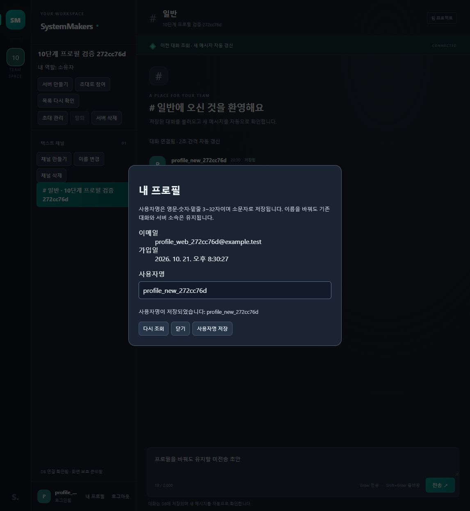
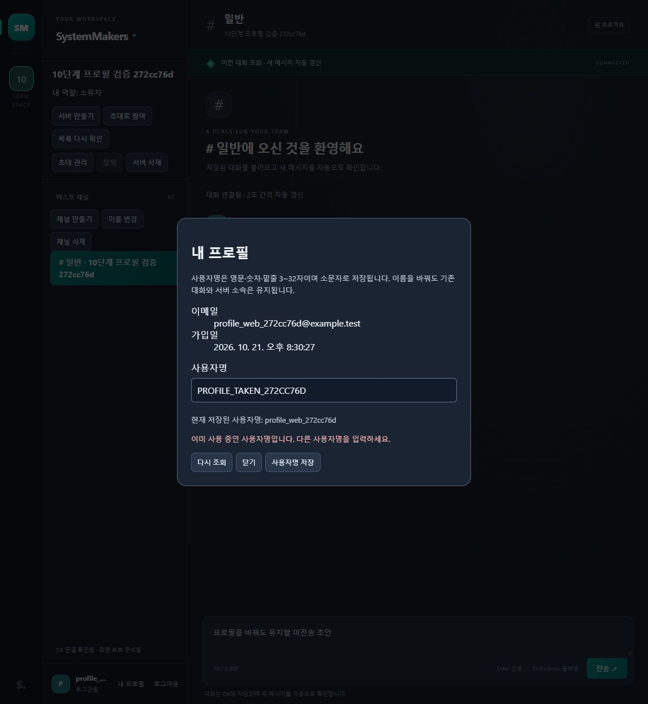
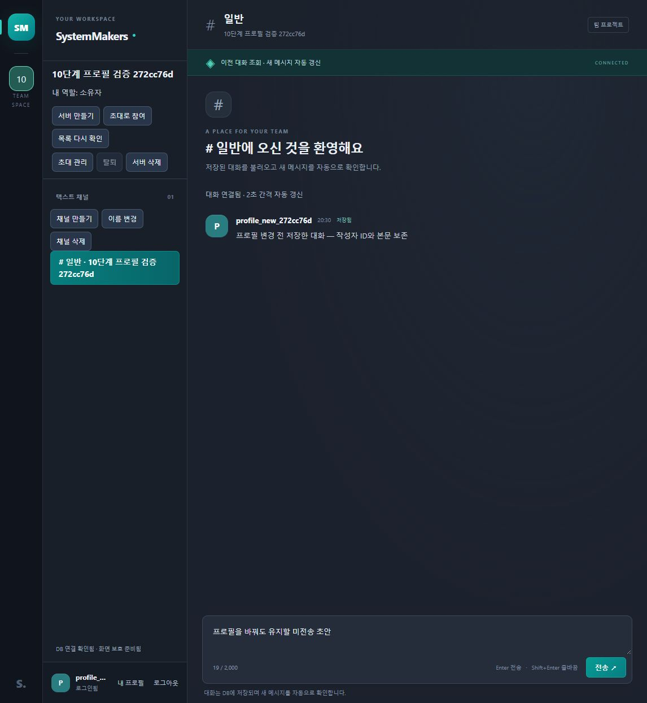

---
# 10단계 본인 프로필 구현·검증 결과

검증일: 2026-10-21 · 작업 기준: main 94df509 · 계약: API 0.8 / DB 문서 0.5.

본인 프로필 조회와 사용자명 수정을 구현했다. 공개 API 경로는 22개이며 profile.php 한 경로에 GET과 PATCH가 있다. 테이블은 기존 8개로 추가 마이그레이션은 없다. 환경은 PHP 8.4.26·MySQL Community Server 8.4.13·실제 로컬 웹이다.

---
## 1. 구현 내용

- GET /api/profile.php: 세션 본인의 id·username·email·created_at만 조회, 미허용 조회 조건 거절.
- PATCH /api/profile.php: username만 허용, 기존 가입 규칙·소문자 정규화·CSRF·기대 계정 적용.
- 본인 users 행 잠금→이름 변경→공개 정보 조회→커밋. 같은 이름 200, 중복 409, DB 실패 롤백.
- 사용자 ID·이메일·암호 해시·가입일·서버 소유자·소속·기존 작성 대화 보존.
- 로그인 하단 내 프로필 버튼, 읽기 전용 이메일·가입일, 사용자명 저장·수동 재조회·닫기 제공.
- 현재 탭의 본인 메시지 이름과 사용자 이니셜 갱신. 초안·대화·기록 커서·예약 유지.
- 중복·형식·CSRF 오류의 입력 보존. 저장 응답 유실은 GET 확인, PATCH 자동 반복 없음.
- 조회 실패 시 저장 차단. 닫기·로그아웃의 이메일·입력 폐기, 이전 계정의 늦은 결과 차단.

---
## 2. 자동 검사

| 항목 | 결과 |
|---|---|
| 전체 node --test | 150개 통과, 실패·건너뜀 0 |
| 기존 기준 | 9단계까지 130개 유지 |
| 프로필 공개 API | 상위 그룹 포함 9개 |
| 프로필 실제 화면 | 8개 |
| 앱 회귀 추가 | PATCH 전달·이름 캐시 보존·중첩 인증 복구 3개 |
| PHP 문법 | 41개 통과 |
| JavaScript 문법 | 6개 통과 |
| Git 공백 검사 | 통과 |

API는 33361 전용 MySQL의 무작위 DB와 실제 PHP·공개 HTTP·독립 인증 세션을 사용한다. 인증·허용 메서드·공개 필드·조회 조건·CSRF·기대 계정·변경 필드·입력 길이·본문 유형/크기, 같은 이름·중복·잠금 대기 중 타 계정 이름 선점·강제 DB 실패를 검사했다. 기존 이메일·비밀번호로 로그인하고 과거 메시지의 작성자 ID와 최신 이름을 확인했다.

화면 검사는 실제 mountProfileUI·ServerManager와 app.js·MessageFeed를 사용하고 DOM·네트워크·시계 경계만 대체했다. 입력 보존·계정 전환·늦은 응답·응답 유실·이름 캐시·조회 커서 보존을 확인했다.

---
## 3. 독립 검토와 수정

독립 검토에서 프로필 CSRF 복구 중 이전 계정의 늦은 401이 새 로그인 계정을 종료하는 P2 한 건을 발견했다. 실제 serverFailure 경로로 수정 전 새 계정 ID가 null로 바뀌는 실패를 재현했다. 복구 시작 당시 인증 세대·사용자 ID를 중첩 호출까지 전달하고 적용 전에 확인하도록 수정했다.

수정 후 새 계정과 CSRF 토큰 보존 검사 통과, 독립 재검토의 관련 17개 통과·추가 결함 없음 확인 뒤 최종 전체 150개를 재실행했다.

---
## 4. 실제 웹과 자료 보존

1. 공개 API로 별도 검증 계정 2개·서버 1개·채널 1개·기존 대화 1개 준비.
2. 웹에서 검증 계정 로그인, 내 프로필의 본인 이메일·가입일·사용자명 조회.
3. 다른 검증 계정의 대문자 이름 입력→중복 오류, 입력 보존·원래 저장 이름 유지 확인.
4. 앞뒤 공백·대문자가 있는 새 이름 저장→소문자 정규화·저장 성공 안내 확인.
5. 기존 대화의 작성자명 즉시 갱신, 본문·서버·채널·미전송 초안 유지 확인.
6. 프로필 닫기 후 이메일·입력 폐기, 페이지 새로고침 후 새 이름과 기존 대화 복원.
7. 로그아웃 후 기존 이메일·비밀번호로 웹 재로그인, 새 이름 복원 확인. 별도 소유자 공개 API에서도 같은 사용자 ID·작성자 ID·본문·소속 유지 확인.
8. 이번 검증 서버만 공개 API로 삭제하고 정확한 ID·이메일의 임시 계정 2개 정리. 이전에 기록한 users·servers·server_members·channels·messages 전체 값과 정리 후 값의 일치 확인. 암호 해시도 비교했고 공개하지 않았다.
9. 기존 local_user 화면 복원. 사용자 1·서버 1·채널 3·대화 3·테이블 8개 유지.

새로고침 시 미전송 초안을 영구 저장하는 기능은 없다. 초안 보존 확인은 같은 탭에서 프로필을 저장하는 동안의 보존이다. 다른 탭의 즉시 이름 동기화·여러 브라우저 전체 호환성·실제 휴대폰·운영 부하는 이번 검사에 포함하지 않았다.

---
## 5. 남은 단계

- 11단계: 가입·로그인·서버·채널·프로필·대화·탈퇴 전체 연결, 여러 탭·브라우저·실제 휴대폰 확인.
- 12단계: 운영 호스팅·HTTPS·프록시·백업 복원·부하 목표·제한 버킷 정리 스케줄.
