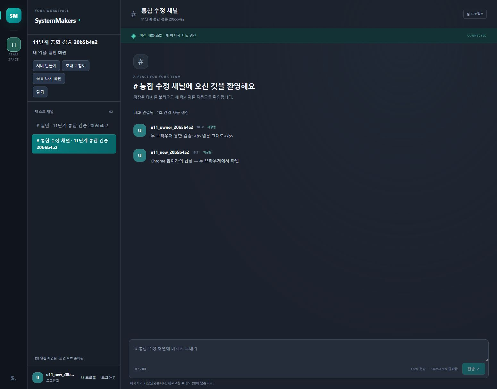
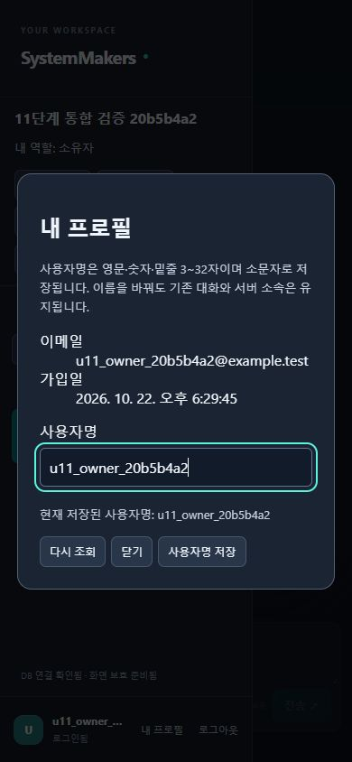
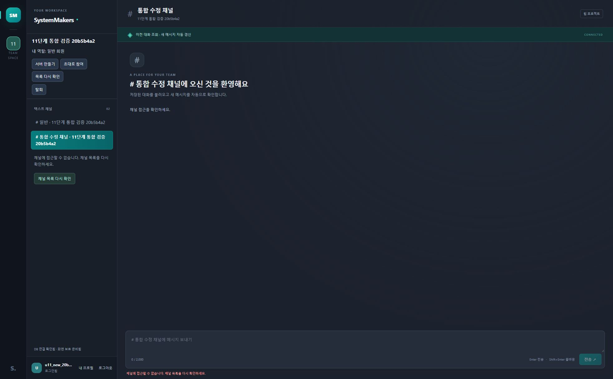
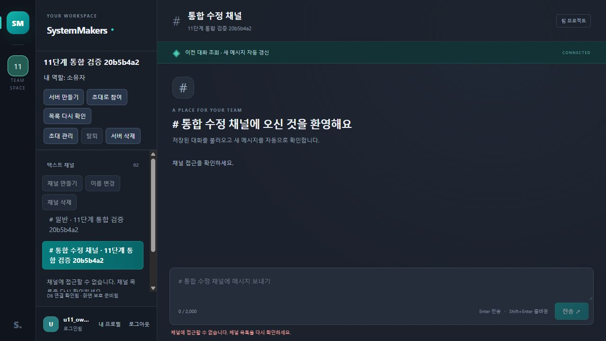

---
# 11단계 로컬 통합 검증·수정 결과

검증일: 2026-10-22 · 시작 커밋: main 7aba010 · 계약: API 문서 0.9 / DB 문서 0.5.

**로컬 통합 검증과 발견 결함 수정을 완료했다. 전체 자동 검사 165개가 통과했다. 실제 휴대폰·Safari·Firefox와 운영 환경은 미검증이며 11단계 전체 완료 판정은 보류한다.** 새 API·테이블·마이그레이션은 없다.

---
## 1. 환경과 최종 검사

| 항목 | 결과·범위 |
|---|---|
| 환경 | Windows, Node 24.19.0, PHP 8.4.26, MySQL Community Server 8.4.13 |
| 개발 웹·DB | 127.0.0.1:8088 / 개발 DB33360, 기존 자료 보존 |
| 자동 검사 DB | 별도33361, 검사마다 무작위 DB 생성·해당 DB만 제거 |
| 기준 검사 | 수정 전 기존150개 통과 |
| 최종 node --test | 165개 통과, 실패·건너뜀0 |
| 추가 검사 | seed 없는 API 전체 흐름6개(상위 그룹 포함), 앱 회귀6개, 서버 화면1개, 선택 저장1개, SQL 실행 도구1개 |
| PHP 문법 | 기존41개 + 검사 SQL 도구1개 =42개 통과 |
| 화면 JS 문법 | frontend의6개 통과 |
| Git 공백 검사 | 통과 |
| 독립 검토 | 화면 관련25개 통과·재검토 추가 P1/P2 없음. SQL 도구 추가 읽기 검토 P1/P2 없음 |

최종 자동 검사는 실제 PHP HTTP 서버·MySQL·세션·CSRF·기대 계정 검사를 사용한다. 화면 회귀는 실제 app.js·관리 모듈·MessageFeed를 실행하고 DOM·네트워크·시계 경계만 대체한다. 독립 검토자의 추가 SQL 실행은 샌드박스 소켓 제한으로 미실행이며, 위 전체165개와 SQL 도구16개 검사는 주 작업자가 실제 실행했다.

---
## 2. 새 전체 흐름 검사

tests/integration-flow.test.mjs는 개발 seed 없이 공개 API만으로 진행한다.

1. 세 회원 가입·로그인, 첫 서버·채널 목록이 비어 있음을 확인.
2. 소유자 서버 생성→기본/추가 채널→초대 발급→일반 회원 두 번 참여. 역할과 소속 중복 없음 확인.
3. 미참여자·일반 회원의 관리 요청 거절과 자료 비노출 확인.
4. 실제 전송55개→최신50개·이전5개→새 답장 after_id 조회. 누락·중복과 채널 혼합 없음 확인.
5. 본인 사용자명 정규화·채널 이름 변경 후 같은 ID·기존 작성 관계·다른 세션의 최신 이름 확인.
6. 일반 회원 탈퇴→공유 쿠키 다른 탭의 조회·전송403→작성 대화55개 보존→재참여 확인.
7. 삭제 미리보기56개→채널 삭제→다른 기본 채널 보존·대상404 확인.
8. 서버 삭제·로그아웃→공유 쿠키 다른 탭401, 계정3개 유지·관련 대화0개 확인.

기존 R01~R12의 역할·초대 만료·요청 제한·잠금 경합·삭제 경쟁·취소·응답 유실 검사는 삭제하지 않고 전체 실행에 포함했다. R05의 admin 경로 등은 기존 자동 검사의 근거이며 이번 두 브라우저의 수동 admin 실행을 뜻하지 않는다.

---
## 3. 재현한 문제와 수정

| 문제 | 수정 전 근거 | 수정과 회귀 확인 |
|---|---|---|
| 403/404 뒤 입력·채널 초안 잔류 | 차단 후 draft가 빈 값이어야 하는 검사 실패 | 입력·초안·읽지 않은 수·스크롤 정리, 차단 채널 재조회 시 이전 초안 복원 금지 |
| 탈퇴·삭제 성공 뒤 목록500으로 이전 자료 잔류 | onReload 전에 폐기 콜백 누락, 선택과 채널 잔류 검사 실패 | 성공 응답 직후 서버 자료·관리 창·저장 선택 폐기 |
| list_servers 소속 종료 확인 뒤 get_channels500 | 사라진 서버의 채널·초안 잔류 검사 실패 | 확인된 서버 목록을 기준으로 채널 재조회 전에 해당 서버 자료 폐기 |
| 활성 채널403 뒤 같은 서버의 비활성 초안 잔류 | 재참여 뒤 비활성 채널의 이전 초안 복원 검사 실패 | 메시지 FORBIDDEN이면 비활성 채널까지 같은 서버 자료 폐기 |
| 전송 CSRF 복구의 늦은401이 새 계정 종료 | 사용자2가 null로 바뀌는 검사 실패 | 복구 성공·실패 적용 전 원래 인증 세대·계정·채널 확인, 새 계정·토큰 유지 |

회귀 검사를 먼저 실패로 확인한 뒤 수정했다. 실패한 변경 요청의 자동 재전송은 추가하지 않았다. 삭제된 채널·탈퇴 서버의 자료를 화면에서 폐기해도 일반 탈퇴자의 DB 작성 메시지는 보존된다.

---
## 4. 검사 실행 도구 문제와 보완

초기 전체 검사에서 기존 스키마·프로필 보존 SELECT가 간헐적으로 exit0·빈 출력으로 반환됐다. 병렬뿐 아니라 순차 실행에서도 발생했다. 앱을 거치지 않는 고정 SELECT 12345 반복에서 MySQL CLI의 stdin·--execute·파일 출력 방식에서도 빈 결과를 재현했다. PHP 고정 출력과 실제 PDO MySQL 조회400회에서는 누락이 없었다. **MySQL CLI 내부의 정확한 원인은 확인하지 못했다.**

동기 SQL 검사만 tests/helpers/sql-query.mjs·sql-query.php의 실제 PDO 연결로 교체했다. SQL을 모사하거나 결과를 재시도하지 않는다. 여러 SQL 결과·NULL·탭/개행/역슬래시·한글/이모지 출력을 기존 배치 형식으로 반환하고 첫/후속 SQL 오류를 실제 MySQL 오류 번호와 비정상 종료로 전달한다. 접속 전에33361과 무작위 검사 DB 이름을 제한한다. 실제 mysql.exe의 대화형 잠금 경합 프로세스는 유지했다.

SQL 도구+기존 스키마16개 통과 후 전체165개를 다시 실행했다. 재실행 전의 실패를 제품 DB 무결성 문제로 단정하지 않았으며, 실패 항목을 건너뛰거나 기대 결과를 낮추지 않았다. 진단용 전역 로그 변경·비우기는 자동 승인 검토에서 거절돼 실행하지 않았다.

---
## 5. 실제 웹과 기존 자료 보존

| 실행 | 실제 확인 |
|---|---|
| 앱 내 브라우저·Chrome | 서로 독립된 쿠키의 두 계정을 화면에서 가입·로그인 |
| 서버·초대·역할 | 화면에서 서버/채널 생성·초대 발급·참여, 일반 회원의 관리 버튼 비노출 |
| 대화·자동 갱신 | 각 브라우저에서 전송한 메시지를 상대 브라우저에서 확인 |
| 본문 원문 | `<b>원문 그대로</b>`가 문자로 표시, 메시지 내부 b 요소0 |
| 이름 변경 | 소유자 채널 이름 변경 뒤 Chrome 목록 재조회로 같은 대화 복원 |
| 프로필 | Chrome에서 사용자명 변경, 본인 기존 메시지 이름 갱신 |
| 작은 화면 | 앱 내 브라우저390×844에서 가로 넘침 없음, 프로필 창·사이드바 접근. 실제 휴대폰 검증 아님 |
| 같은 Chrome 두 탭 | 다른 탭 탈퇴 후 다음 조회에서403, 초안 빈 값·메시지0·입력 차단 |
| 재참여 | 같은 초대로 참여, DB 작성 메시지 보존과 변경한 이름 확인 |
| 공유 쿠키 계정 변경 | 한 탭 로그아웃→다른 계정 로그인, 다른 탭 게스트·초안/메시지/프로필 이메일 정리 |
| 최신 코드의 채널 삭제 | 임시 채널을 API로 삭제→열린 웹의404 처리에서 초안 빈 값·메시지0·입력 차단 |

이번에 만든 서버1개·계정2개만 정리했다. users·servers·server_members·channels·messages 전체 값을 검증 전후 비교했고 암호 해시를 포함해 일치했다. 기존 사용자1명·서버1개·채널3개·메시지3개·테이블8개를 보존했다. 비교 자료·비밀번호·접속 설정·초대 원문은 Git에 포함하지 않았다. 웹은 기존 local_user로 복원했다.









---
## 6. 남은 실제 기기 확인

아래 항목은 **미실행**이다. 기기·OS·브라우저 버전·실행일·담당·결과·재현 순서·화면 증거를 기록해야 11단계 전체 완료를 판정할 수 있다. Safari·Firefox는 연결된 환경이 없었으며 이번 결과로 호환성을 보장하지 않는다.

| 담당 | 확인할 항목 | 완료 기준 |
|---|---|---|
| A | 실제 Android/iPhone, 세로/가로, 소프트 키보드·초점·Enter/Shift+Enter·스크롤 | 입력·전송 버튼·최근/이전 대화 접근과 모달 닫기 가능, 내용 가림 없음 |
| A/C | 서버/채널/프로필 창·역할·삭제 취소·빈 서버 | owner/admin/member별 허용/거절이 규칙과 일치 |
| A/B/C | 두 회원·여러 탭, 이전/신규 대화, 탈퇴·삭제·계정 변경 | 확정된 접근 종료 후 기존 초안·기록·관리 입력 폐기, 정상 대화 누락 없음 |
| B | 오류 시 실제 HTTP·세션·DB 상태 추적 | 재현 가능한 실패 검사와 수정 뒤 전체165개 및 해당 기기 재검증 |

운영 HTTPS·프록시·최소 DB 권한·백업 복원·부하 검증은12단계다. 호스팅·도메인·예산·동시 사용자·복구 시간 목표는 아직 정하지 않았다. 후속 역할은 [최신 개발 방향](DEVELOPMENT-DIRECTION.md#3-팀원별-다음-작업)을 따른다.

---
## 7. 실행과 문서 기준

PHP_TEST_BIN·MYSQL_TEST_CLIENT·MYSQL_TEST_PORT=33361 및 README의 웹 검사 환경을 설정한 뒤 실행한다. 개인 실행 파일은 새 체크아웃에 포함되지 않으므로 별도 준비한다.

```powershell
node --test # 전체165개 실제 DB·화면 상태 검사
node --test tests/integration-flow.test.mjs # seed 없는 공개 API 전체 흐름
node --test tests/sql-query.test.mjs tests/schema.test.mjs # 실제 SQL 도구와 DB 제약 검사
node --check frontend/app.js # 화면 스크립트 문법 검사
git diff --check # 변경 내용 공백 검사
```

현재 기준 문서는 README·DEVELOPMENT-DIRECTION·PHASE-7-RULES·API0.9·DATABASE0.5와 이 보고서다. 2~10단계 보고서의 당시 검사 수·커밋은 역사 기록으로 유지한다. Google 문서의 ‘남은 개발 로드맵·쉬운 설명’ 탭에도 로컬 결과·남은 기기 확인·A/B/C 작업을 같은 기준으로 반영한다.
