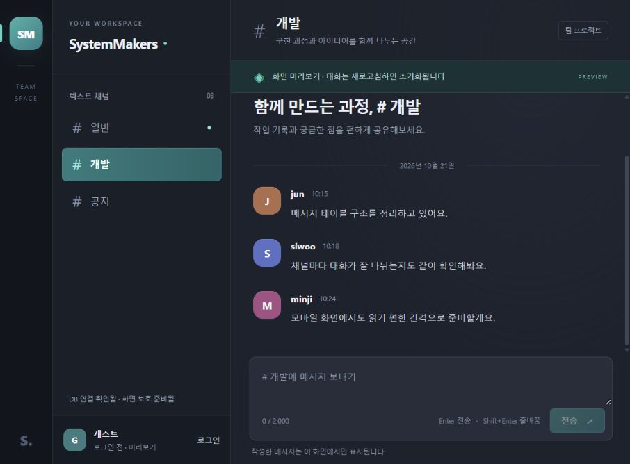

---
# PHP 공통 처리와 웹 화면 검증 결과

검증일: 2026-10-21. PHP 공통 계층과 실제 로컬 웹 화면을 추가하고 전체 테스트 35개를 통과했다. 회원가입·로그인 처리와 메시지 DB API는 후속 단계다.

---
## 구현 결과

| 구분 | 구현 내용 |
|---|---|
| DB 연결 | 명시적인 환경 설정, PDO, utf8mb4·UTC, 실제 prepared statement, 문자열 ID |
| 응답·입력 | 공통 JSON, 상태 코드, 32 KiB 제한, JSON 객체·필드·ID·쿼리 키 검사 |
| 세션 | 전용 쿠키, HttpOnly·SameSite·운영 Secure, strict mode, 유휴·최대 만료 |
| 인증·권한 | 실제 계정 조회, 비로그인 401, 채널 없음 404·비회원 403 |
| CSRF | 세션별 64자리 토큰, 정상 게스트 조회에서 기존 토큰 유지 |
| 공개 API | GET csrf.php, get_current_user.php, health.php |
| 웹 화면 | 채널별 예시 대화·초안·로컬 전송, 인증 화면 전환, 모바일 목록 |
| 공개 범위 | frontend 정적 파일과 API 허용 목록만 제공, 내부 파일 404 |

health.php는 실제 DB 연결만 확인한다. 화면에는 미리보기와 새로고침 시 대화 초기화를 표시한다. 인증 폼은 준비 중이며 비밀번호를 서버로 보내거나 저장하지 않는다. 요청에 따라 사이드바의 짧은 안내 문장 두 개와 관련 스타일을 제거했다.

---
## 실행 환경과 명령

Windows, PHP 8.4.26의 pdo_mysql·mbstring 확장, MySQL 8.4.13, Node.js 24.19.0에서 확인했다. DB는 프로젝트 전용 127.0.0.1:33360을 사용하고 웹은 127.0.0.1:8088에서 실행한다. 8080은 다른 프로젝트가 사용하고 있어 변경했다. 기존 프로젝트의 서버는 종료하지 않았다.

전체 테스트는 MYSQL_HOST·MYSQL_PORT·MYSQL_DATABASE·MYSQL_USER·MYSQL_PASSWORD, 개발 세션 설정과 MYSQL_TEST_CLIENT·MYSQL_TEST_PORT를 지정한 환경에서 저장소 루트의 `node --test`로 실행한다. 각 DB 테스트는 임의 이름의 테스트 DB만 생성·삭제하며 개발 DB 데이터는 유지한다.

| 검증 | 결과 |
|---|---|
| PHP 공통 계층과 실제 HTTP API | 16개 통과 |
| 기존 MySQL 스키마 | 15개 통과 |
| 실제 웹 라우터와 비공개 경로 차단 | 4개 통과 |
| 전체 | 35개 통과, 실패 0개, 건너뜀 0개 |
| PHP 파일 문법 | backend 11개와 router.php 모두 통과 |
| 프론트 JS 문법 | node --check frontend/app.js 통과 |
| 실행 포트 충돌 | 8088 재실행 거절과 기존 사이트 HTTP 200 유지 확인 |

테스트 숫자에는 각 그룹의 상위 테스트가 포함된다. PHP 서버 테스트의 준비 응답·정적 자원 응답은 본문까지 소비하여 연결을 정리한다.

---
## 회귀 검증과 코드 검토

게스트 상태 조회가 인증 실패 처리와 합쳐져 이미 발급한 CSRF를 폐기하는 문제를 발견했다. 토큰 발급 → 같은 쿠키로 게스트 401 조회 → 같은 토큰 유지 → 해당 토큰으로 테스트 POST 성공 순서를 먼저 실패시키고 수정했다.

만료·삭제·손상 계정 검사는 각각 새 세션과 쿠키로 준비한다. 준비한 사용자 ID·인증 시각을 확인하고 유휴 만료 전·최대 수명 만료 전 정상 상태도 검사한다. 만료 검사에서 폐기된 쿠키를 다음 사례에 재사용하지 않는다. 수정된 두 항목은 별도 코드 재검토에서 해결 확인을 받았다.

---
## 브라우저 확인

실제 브라우저에서 홈 화면, 채널 목록 열기·닫기, 개발 채널 선택과 대화 분리, 메시지 미리보기 추가, 로그인·회원가입 화면 전환을 확인했다. 두 삭제 요청 문구가 사라진 채널 목록도 확인했다. 좁은 오른쪽 패널에서는 목록을 접는 모바일 레이아웃으로 표시하며, 넓은 패널에서는 채널 목록과 대화를 함께 표시한다.

최종 접속 주소는 [로컬 SystemMakers](http://127.0.0.1:8088/)다. 공개 호스팅 주소가 아니며 로컬 PHP·MySQL 프로세스가 실행 중일 때 접속할 수 있다. PNG 시안과 별개로 실제 HTML·CSS·JavaScript로 동작한다.

---
## 남은 순서

3단계는 회원가입·로그인·로그아웃 API와 실제 인증 화면 연동이다. 4단계는 메시지 저장, 5단계는 메시지 조회·폴링, 6단계는 회원·채널·메시지 전체 흐름 검증과 문서 확정이다. C의 서버·채널 관리 기능은 별도 담당 범위를 유지한다.
