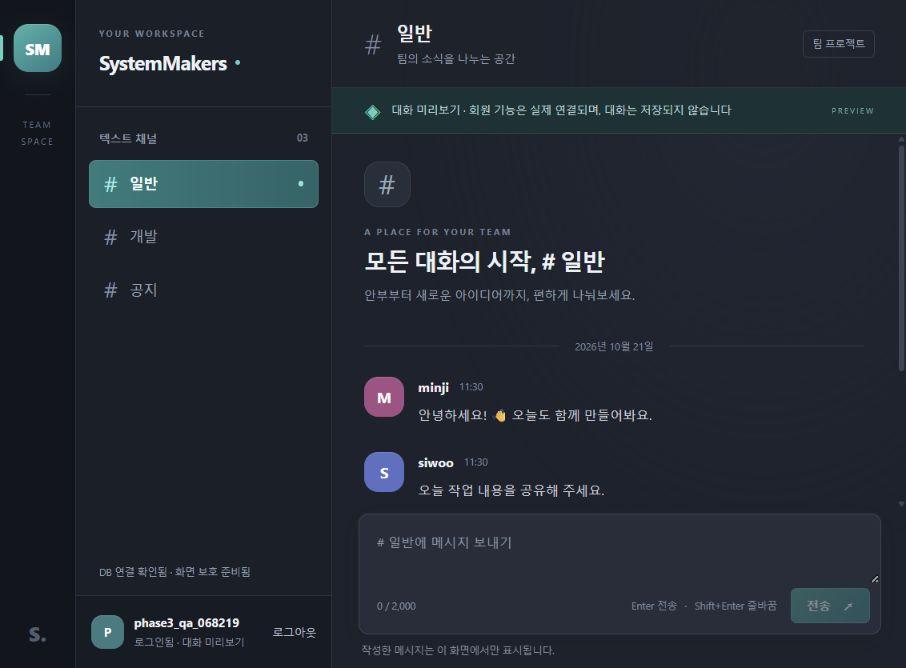

---
# 3단계 회원 인증과 웹 연동 검증 결과

검증일: 2026-10-21. 실제 MySQL 회원가입·비밀번호 해시 확인·PHP 세션 로그인·로그아웃을 구현하고 현재 웹사이트에 연결했다. 메시지는 계속 로컬 미리보기이며 DB 저장·조회는 후속 단계다.

---
## 구현 결과

| 파일·영역 | 결과 |
|---|---|
| register.php | 사용자명·이메일 정규화, 입력·중복 검사, 비밀번호 해시 저장, 201 공개 사용자 응답 |
| login.php | 실제 해시 검증, 공통 자격 증명 오류, 세션 ID·CSRF 교체, 유효한 기존 로그인 거절 |
| logout.php | 인증·CSRF 검사, 서버 세션 삭제, 같은 속성의 쿠키 만료 |
| accounts.php | 문자·바이트 검증, 이메일 우선 중복, 문자열 ID와 UTC 공개 응답 |
| login_rate_limit.php | HMAC 키, 두 버킷 원자적 갱신, 이메일 5회·IP 30회, 15분 고정 창 |
| 웹 인증 | 실제 가입 후 별도 로그인, 오류 안내, 현재 사용자 표시, 새로고침 후 인증 복원 |
| 로그아웃 화면 | 사용자·대화·초안·이전 토큰 제거와 새 게스트 토큰 발급 |
| 공통 보호 | POST·JSON·CSRF 검사, 중복 제출 차단, 비공개 파일 접근 차단 유지 |

사용자명·이메일은 앞뒤 공백 제거와 소문자 저장을 적용한다. 비밀번호 원문은 변형하지 않고 12~64 코드 포인트·최대 72바이트·NUL 불허 조건으로 검사한다. 가입만으로 로그인이나 서버 멤버십을 만들지 않는다.

---
## 실행 환경과 최종 전체 검사

Windows, PHP 8.4.26의 pdo_mysql·mbstring 확장, MySQL 8.4.13, Node.js 24.19.0에서 확인했다. 로컬 웹 주소는 [SystemMakers](http://127.0.0.1:8088/), DB는 프로젝트 전용 127.0.0.1:33360이다. PHP 개발 서버는 로그인 제한 키가 적용된 개인 설정으로 다시 실행했다.

최종 `node --test`는 MYSQL_HOST·MYSQL_PORT·MYSQL_DATABASE·MYSQL_USER·MYSQL_PASSWORD·AUTH_RATE_LIMIT_KEY와 세션·MySQL 테스트 설정을 프로세스에 주입한 뒤 실행했다. 실제 값은 Git에서 제외했다. 각 통합 검사는 무작위 테스트 DB와 별도 세션 저장소를 사용하고 자신이 생성한 DB만 삭제한다.

| 검사 | 결과 |
|---|---|
| 신규 회원 인증 | 12개 통과 |
| 기존 PHP 공통 계층 | 16개 통과 |
| 실제 웹 라우터·회원 공개 경로·비공개 파일 차단 | 5개 통과 |
| 기존 스키마 | 15개 통과 |
| 전체 | 48개 통과, 실패 0개, 건너뜀 0개 |
| PHP 문법 | backend 16개와 router.php, 합계 17개 통과 |
| JavaScript 문법 | node --check frontend/app.js 통과 |
| 한글 주석 | 코드 파일 26개의 줄별 주석 점검, 중괄호만 있는 줄 제외 |

테스트 개수에는 각 그룹의 상위 테스트가 포함된다. 백엔드 담당자의 앞선 전체 실행은 웹 라우터용 MYSQL_* 설정 누락으로 한 검사가 500을 반환했다. 위 최종 실행은 실제 런타임 설정을 주입해 해당 검사를 포함한 전체 48개를 통과했다.

---
## 테스트 우선 검증과 회귀 수정

새 회원 API를 구현하기 전 실제 가입 응답 404를 확인했다. 공개 라우터 검사도 새 회원 API가 POST 전용 405에 도달하지 못하고 404를 반환하는 실패를 먼저 확인한 뒤 연결했다.

동일한 게스트 쿠키로 동시에 로그인하면 먼저 성공한 요청 이후의 오래된 요청이 새 게스트 쿠키를 발급할 수 있었다. 이를 네 PHP 프로세스로 재현하고, 이전 세션 ID·토큰과 달라진 실패 응답에서는 Set-Cookie를 제거했다. 실제 인증은 한 번만 성공하고 오래된 응답은 인증 상태를 복원하거나 성공 쿠키를 덮지 않는다.

다른 탭에서 이미 로그인한 경우 화면이 사용자만 복원하고 이전 CSRF를 유지하는 문제도 수정했다. 기존 토큰 제거 → 실제 사용자 확인 → 새 토큰 조회를 완료한 경우에만 모달을 닫는다. 사용자 또는 토큰 조회 실패는 성공으로 처리하지 않는다. 수정 전 실패와 수정 후 통과를 확인하고 별도 읽기 코드 재검토에서 해결 확인을 받았다.

---
## 실제 PHP·MySQL 검사 범위

- 실제 가입, 대소문자·앞뒤 공백 정규화, 비밀번호 원문 공백 보존과 해시 검증.
- 이메일 우선 중복, 사용자명 중복, 네 프로세스의 동시 UNIQUE 충돌.
- 메서드·본문·인증·CSRF·필드 우선순위와 검증 실패 시 DB 쓰기 없음.
- 비밀번호 최소·최대 문자 수와 한글·이모지 바이트 경계, NUL·잘못된 자료형·필드 거절.
- 없는 계정과 잘못된 비밀번호의 동일 401, 로그인 ID·토큰 교체, 이전 쿠키와 로그아웃 세션의 인증 차단.
- 유휴 만료 후 게스트 전환, 이전 CSRF 거절, 제한 비밀 키 누락 시 로그인 실패 폐쇄.
- 성공 포함 이메일 5회, IP 30회, 세션 교체·위조 프록시 헤더에 따른 우회 거절.
- 차단 시 횟수 보존, 15분 창 만료 초기화, 네 PHP 프로세스 동시 요청의 제한 원자성.

---
## 실제 브라우저 확인

1. 테스트 계정을 실제 가입하고 소문자 이메일·빈 비밀번호의 로그인 화면으로 전환 확인.
2. 잘못된 비밀번호의 실제 실패 안내와 비밀번호 필드 초기화 확인.
3. 정상 로그인 후 실제 사용자명·로그아웃 버튼 표시와 새로고침 후 인증 유지 확인.
4. 미리보기 대화와 초안을 만든 뒤 로그아웃하여 사용자·대화·초안 초기화 확인.
5. 두 탭을 게스트 상태로 열고 한 탭에서 로그인한 뒤 기존 탭의 제출에서 실제 사용자·최신 토큰 복구 확인.
6. 복구 직후 첫 로그아웃 성공과 재접속 시 게스트 상태 확인.

브라우저 확인은 현재 로컬 실행 환경에서 수행했다. 운영 HTTPS·프록시·호스팅 환경은 미확정이며 공개 배포 성공으로 해석하지 않는다. 메시지 저장·조회·폴링은 아직 제공하지 않는다.

---
## 다음 단계

4단계는 인증된 사용자의 채널 권한을 확인한 메시지 저장, 5단계는 조회·이전 이력·신규 폴링과 화면 연결, 6단계는 회원·채널·메시지 전체 흐름 검증이다.
