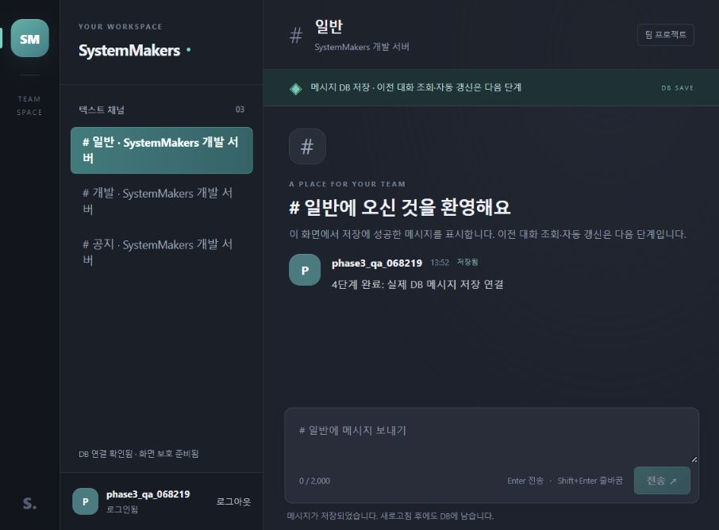

---
# 4단계 메시지 저장과 웹 연동 검증 결과

검증일: 2026-10-21. 실제 채널 목록과 메시지 저장 API를 웹사이트에 연결했다. 저장 성공 응답을 받은 메시지만 화면에 표시하며, 새로고침 후에도 DB에는 남는다. 이전 대화 불러오기·신규 폴링은 5단계다.

---
## 구현 결과

| 영역 | 구현 |
|---|---|
| send_message.php | 로그인·CSRF·입력·채널·현재 소속 검사, 실제 INSERT와 201 응답 |
| messages.php | 원문 검증·공개 응답, 채널 배타 잠금·멤버십 공유 잠금·트랜잭션 |
| get_channels.php | 세션 사용자 소속의 실제 채널만 조회, 문자열 ID와 서버 이름 |
| 개발 데이터 | 기존 계정을 명시하는 CLI, 개발·테스트 환경 제한, 재실행과 기존 자료 보존 |
| 웹 전송 | 실제 채널 선택, 저장 성공 표시, 중복 요청 차단, 원문 textContent 렌더링 |
| 실패 처리 | 초안 보존, 세션 만료 복구, CSRF 수동 재제출, 통신 실패의 중복 가능성 안내 |

작성자는 요청 본문 대신 인증 세션에서 결정한다. 메시지는 원문 1~2,000 코드 포인트이며 공백 전용·NUL·잘못된 UTF-8·알 수 없는 필드를 거절한다. 앞뒤 공백·개행·태그 문자열은 변형하지 않고 저장한다.

---
## 실제 테스트 결과

PHP 8.4.26, MySQL 8.4.13, Node.js 24.19.0의 Windows 개발 환경에서 확인했다. 로컬 웹은 127.0.0.1:8088, DB는 프로젝트 전용 127.0.0.1:33360이다.

기존과 같은 개인 DB·세션 환경 변수와 MYSQL_TEST_CLIENT·MYSQL_TEST_PORT를 주입한 뒤 저장소 루트에서 node --test를 실행했다. API 테스트는 무작위 독립 DB와 세션 저장소를 사용하며 개발 DB와 기존 대화를 삭제하지 않는다.

| 검사 | 결과 |
|---|---|
| 회원 인증 | 12개 통과 |
| PHP 공통 계층 | 16개 통과 |
| 채널 목록과 개발 데이터 | 7개 통과 |
| 실제 메시지 저장·경합·롤백 | 10개 통과 |
| 공개 라우터·비공개 파일 차단 | 5개 통과 |
| 기존 스키마 | 15개 통과 |
| 전체 | 65개 통과, 실패 0개, 건너뜀 0개 |
| PHP 문법 | backend 19개·router.php·seed-dev.php, 합계 21개 통과 |
| 프런트 JS | node --check frontend/app.js 통과 |

테스트 숫자에는 그룹의 상위 테스트를 포함한다. 별도 프런트 행동 모의 검사는 보조 검증이며 위 65개 실제 HTTP·MySQL 검사 숫자에 포함하지 않았다. 최종 diff 검사에서 발견한 HTML 끝 빈 줄은 제거하고 다시 검사했다.

---
## 테스트 우선 검증과 동시성

메시지 API 미구현 상태의 404≠201, 채널 목록 미구현 상태의 404≠200과 개발 스크립트 부재를 먼저 확인한 뒤 구현했다.

동시성 검사는 네 PHP 프로세스와 실제 MySQL 잠금을 사용한다. 같은 세션의 전송도 PHP 세션 잠금을 먼저 해제하여 DB까지 진행되는지 확인했다. 앞선 INSERT를 실제 사용자 외래 키 잠금으로 지연시키고 후속 요청이 채널 잠금에서 기다리는지, 후속 ID가 먼저 발급·커밋되지 않는지 확인했다.

멤버십 공유 잠금이 유지되는 동안 탈퇴 요청이 대기하고 전송 커밋 이후 진행되는지 확인했다. 실제 INSERT 오류는 메시지를 남기지 않고 롤백하며 내부 SQL·접속 정보는 응답하지 않는다.

테스트 연결의 잠금 시간 제한을 사용해 시간 초과 뒤 새 트랜잭션으로 재시도하는 경로를 검증했다. 실제 트랜잭션이 두 번 관측된 뒤 단일 저장 성공, 세 번 관측된 뒤 공통 500과 잠금 해제를 확인했다. 실제 1213 교착 오류를 강제하는 검사는 수행하지 않았으며 1205 시간 초과로 공통 롤백·재시도 경로를 검증했다.

---
## 개발 데이터와 권한

scripts/seed-dev.ps1이 개인 실행 환경을 읽고 CLI PHP를 호출한다. 이미 가입한 소유자와 선택한 추가 멤버만 사용한다. 새 계정·비밀번호는 만들지 않으며 운영 APP_ENV와 웹 실행을 거절한다.

독립 DB에서 재실행 시 서버·채널 중복 생성 없음, 기존 대화 보존과 기존 admin 역할 보존을 확인했다. 없는 계정을 지정하면 전체 준비를 취소한다. 실제 로컬 웹 확인에는 지정한 검증 계정 한 명의 개발 공간을 준비했으며 다른 가입 계정은 자동 가입시키지 않았다.

---
## 실제 브라우저 확인

1. 게스트 상태에서 채널·작성 입력·전송이 비활성화된 상태 확인.
2. 기존 계정 로그인 후 DB의 일반·개발·공지 채널 ID와 서버 이름 표시 확인.
3. 일반·개발 채널에 서로 다른 메시지를 실제 저장하고 선택한 채널에만 표시 확인.
4. 개행과 b 태그 문자열이 일반 텍스트로 표시되고 HTML 요소로 실행되지 않음을 확인.
5. 새로고침 시 인증·채널을 복원하고 이전 메시지는 아직 불러오지 않는 상태 확인. 기존 메시지가 실제 DB에 남는 것도 별도 SELECT로 확인.
6. 새 가입 계정으로 로그인하여 빈 소속 목록과 전송 차단 확인.
7. 다시 기존 계정으로 로그인해 최종 메시지를 저장하고 실제 화면 기록.

---
## 코드 검토와 수정

별도 읽기 검토에서 발견한 전송 중 로그아웃 경합을 수정했다. 로그아웃 실패가 먼저 인증 상태 번호를 바꾸면 이미 저장된 메시지의 성공 응답이 무시될 수 있어, 전송 중에는 버튼과 함수 진입 모두에서 로그아웃을 차단한다. 수정 전 행동 검사 실패와 수정 후 통과를 확인했다.

고정된 예시 날짜를 제거하고, 빈 채널의 모바일 목록에서는 표시되고 활성화된 요소로 포커스를 이동한다. 개발 데이터 재실행의 admin 보존 검사도 보강했다. 집중 재검토에서 지적 사항의 해결을 확인했다.

모든 변경 코드는 Allman 스타일과 줄별 짧은 한국어 주석을 적용한다. 운영 호스팅·프록시 환경은 아직 확정하지 않았다.
