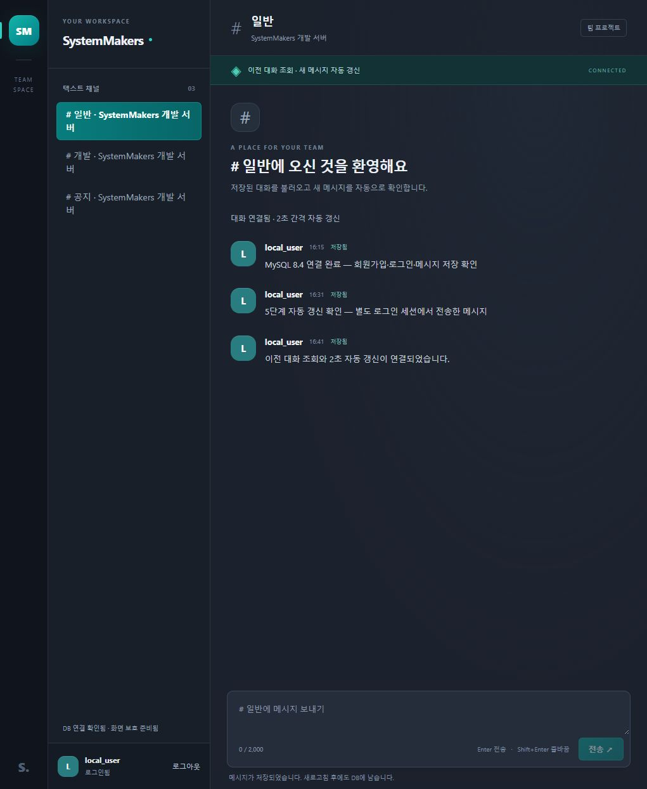

---
# 5단계 대화 조회와 자동 갱신 검증 결과

검증일: 2026-10-21. PHP 8.4.26·MySQL 8.4.13·Windows에서 실제 조회 API와 웹사이트를 확인했다. 기존 4단계의 인증·저장에 최초·이전·신규 조회와 폴링을 연결했다.

---
## 구현 결과

| 영역 | 확인한 동작 |
|---|---|
| get_messages.php | GET·인증·허용 쿼리·ID·개수·방향 충돌 검사, 실제 페이지 응답 |
| message_history.php | 채널·현재 멤버십 공유 잠금, 채널별 ID 범위와 limit+1 조회, 응답 전 커밋·오류 롤백 |
| 페이지 계약 | 기본 50개·최대 100개, 오름차순 반환, 실제 최소·최대 ID 커서, 빈 신규 결과의 기존 커서 유지 |
| MessageFeed | 완료 후 2초 예약, 신규 적체 순차 소진, 최대 30초 오류 대기, 성공 후 정상 간격 복구 |
| 상태 분리 | 채널별 기록·신규/이전 커서·초안·위치, ID 중복 제거, 큰 ID 문자열 비교 |
| 취소와 권한 | 채널 이동·계정 종료의 요청 취소, 늦은 결과 무시, 401·403·404의 기록 정리와 조회 종료 |
| 전송 경합 | 내 저장 응답으로 신규 커서 전진 없음, 권한 상실 후 도착한 성공 응답의 대화 복원 차단 |
| 화면 | 최신 기록 복원, 이전 대화 더 보기, 연결 상태·수동 재연결·새 메시지 이동 버튼 |

새 프레임워크·외부 패키지·DB 스키마 변경 없이 구현했다. 메시지 본문은 textContent로 표시한다. 운영 호스팅과 C의 서버·채널·프로필 관리 기능은 이번 단계에 포함하지 않는다.

---
## 자동 검사

실제 개발 DB는 127.0.0.1:33360, 별도 검사 MySQL은 127.0.0.1:33361을 사용했다. 각 통합 검사는 무작위 전용 DB와 세션 저장소를 생성하고 그 자원만 정리한다. 개인 환경 변수와 실행 도구는 Git에서 제외했다.

| 검사 | 결과 |
|---|---|
| 기존 인증·공통 처리·소속 채널·저장·라우터·스키마 | 기존 65개 통과 |
| 실제 최초·이전·신규 조회 | 6개 통과 |
| 조회 모듈의 타이머·커서·경합·오류·권한 | 8개 통과 |
| 전체 node --test | 79개 통과, 실패 0개, 건너뜀 0개 |
| 전체 PHP 문법 | backend 21개·router.php·seed-dev.php, 합계 23개 통과 |
| JS 문법 | app.js·message-feed.mjs 통과 |
| 공백·충돌 검사 | git diff --check 통과 |

테스트 숫자에는 그룹의 상위 테스트를 포함한다. Node 조회 모듈 검사는 실제 MessageFeed를 실행하며 네트워크 응답과 타이머만 제어 가능한 경계로 교체한다. 별도의 HTTP 검사는 실제 PHP·MySQL과 공개 라우터를 실행한다.

신규 조회 검사를 먼저 실행해 미구현 API의 404와 모듈 부재를 확인한 뒤 구현했다. 실제 HTTP 검사에는 최신 50개·최대 100개, 125개 신규 기록의 페이지 분리, 틈이 있는 ID, 빈 결과, 중복·알 수 없는 쿼리, 권한 상실, 2^53 초과 ID와 한글·태그·개행 원문을 포함했다.

---
## 실제 브라우저 확인

1. 기존 local_user 세션에서 새로고침 후 DB에 있던 메시지 복원 확인.
2. 별도 쿠키 세션으로 실제 로그인·send_message.php 전송 후, 열린 화면에서 새로고침 없이 신규 메시지 수신 확인.
3. 전용 임시 채널에 105개 검증 기록을 준비하고 최초 50개인 56~105번 표시 확인.
4. 이전 대화 버튼으로 6~105번 100개 표시 확인. 대화 높이는 3994에서 7728, scrollTop은 0에서 3734로 바뀌어 기존 읽는 메시지의 위치 유지 확인.
5. 초안 입력 후 개발 채널로 이동하여 메시지·초안 분리 확인. 원래 검증 채널로 돌아와 100개 기록·초안·scrollTop 3734 복원 확인.
6. 다시 이전 대화를 조회하여 1~105번 전체 표시와 추가 조회 버튼 숨김 확인.
7. 일반 채널로 복귀한 뒤 이번에 생성한 임시 채널 ID와 이름을 대조하여 검증 채널·105개 기록만 정리. 기존 대화 보존 확인.
8. 실제 로그아웃으로 대화 0개·게스트·입력 비활성화·로그인 필요 상태 확인. 재로그인 후 일반 채널의 기존 2개 대화 복원 확인.
9. 화면에서 새 메시지를 전송하여 총 3개 표시, 초안 비움 확인. 후속 폴링 이후에도 3개로 중복 없는 상태 확인.

---
## 검토와 회귀 수정

- 실제 브라우저에서 Window 타이머 함수를 조회 객체의 메서드로 호출할 때 Illegal invocation이 발생했다. 전역 객체를 통해 호출하도록 수정하고 동일한 호출 대상 제약을 가진 실패 검사를 먼저 추가한 뒤 통과를 확인했다.
- 독립 코드 검토에서 폴링의 권한 거절 뒤 늦게 도착한 저장 성공 응답이 기록을 다시 표시할 수 있음을 확인했다. 실제 MessageFeed 회귀 검사의 실패를 확인하고 모듈·전송 응답 양쪽에서 blocked 상태를 검사하도록 수정했다.
- 전체 검사에서 기존 동일 게스트의 동시 로그인 4건 중 2건이 성공하는 경합을 관측했다. 최종 세션 잠금에서 기존 상태를 비우고 session_regenerate_id(false)로 교체하여 기존 빈 게스트 상태가 잠금 안에서 먼저 저장되도록 수정했다. 새 인증과 CSRF는 새 세션에만 기록한다. 기존 동시 로그인·실패 응답 쿠키·이전 쿠키 401·로그아웃 검사를 포함한 전체 79개 통과를 확인했다.

---
## 남은 단계

6단계 전체 인수 검증과 운영 환경 확정이 남아 있다. C의 서버 생성·참여·채널·프로필 관리 API는 후속 작업이다. 회원가입만으로 채널 소속이 생기지 않으며 현재는 기존 개발 데이터 준비 CLI로 명시적으로 연결한다.

---
## 검색 참고

- [PHP 세션 교체와 동시 요청 주의사항](https://www.php.net/manual/en/function.session-regenerate-id.php)
