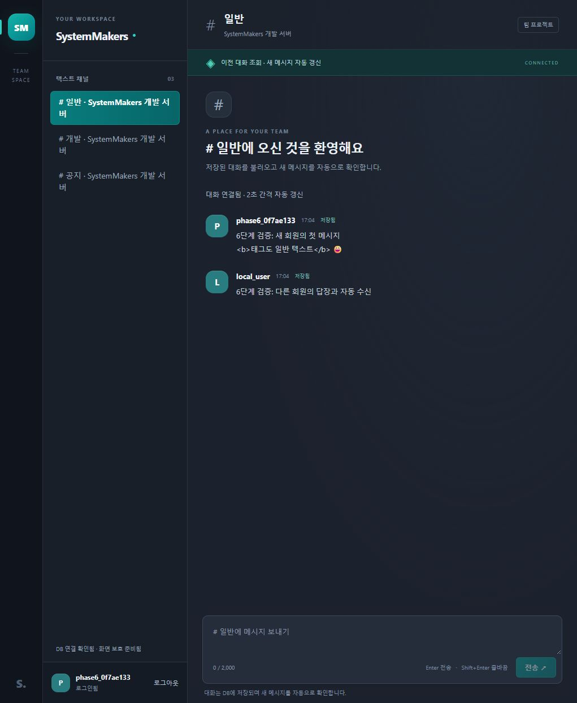
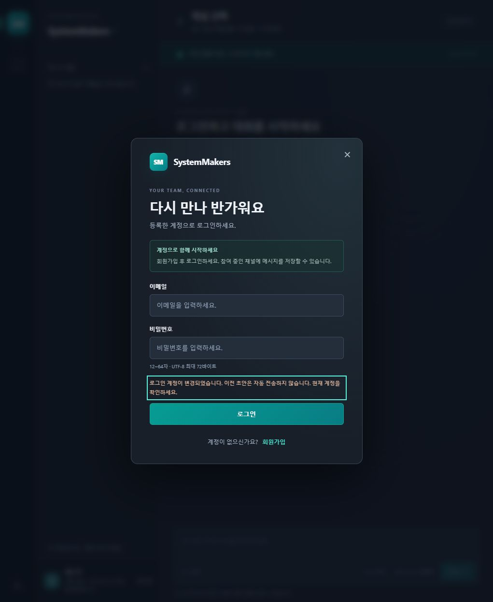

---
# 6단계 회원·채널·메시지 전체 인수 검증

검증일: 2026-10-21. 기준 커밋 efe1c6e에서 실제 공개 API와 웹사이트 전체 흐름을 확인하고, 계정 변경과 권한 상실 관련 결함 2건을 수정했다. 완료 범위는 로컬 B 담당 API와 웹 연동이다.

---
## 환경과 자료 분리

- PHP 8.4.26, MySQL Community Server 8.4.13, Windows.
- 실제 웹사이트 127.0.0.1:8088, 개발 DB 33360, 독립 검사 MySQL 33361.
- 자동 검사는 무작위 DB·독립 PHP·세션 저장소에서 실행하고 해당 자원만 정리.
- 실제 브라우저 가입 계정과 그 계정 소유의 별도 검증 서버·채널을 사용하고 확인 후 정리.
- 기존 local_user, 채널 3개, 기존 대화 3개의 보존을 DB에서 확인.
- 접속 정보·비밀번호·PHP/MySQL·DB·개인 실행 도구는 .runtime에 보관하고 Git에서 제외.

---
## 전체 흐름 판정

| 흐름 | 확인 결과 | 근거 |
|---|---|---|
| 회원가입 | 실제 계정 생성, 정규화·해시, 가입 후 게스트 유지 | 인수·기존 인증 검사, 실제 웹 가입 |
| 중복·실패 로그인 | 중복 409·잘못된 비밀번호 401·로그인 횟수 제한 | 인수·기존 인증 검사 |
| 로그인·복원 | 새 세션·CSRF, 현재 사용자, 새로고침 후 상태 복원 | 인수·기존 인증 검사, 실제 웹 |
| 채널 | 새 회원은 빈 목록·입력 차단, CLI로 명시한 기존 계정만 연결 | 인수 검사, 실제 웹·개발 CLI |
| 전송·표시 | 세션 작성자, 원문·개행·이모지, 태그의 일반 텍스트 표시 | 인수·기존 저장 검사, 실제 웹 |
| 조회·신규 수신 | 다른 회원 메시지 수신·새로고침 복원·중복 없음 | 인수·기존 조회 검사, 실제 웹 |
| 과거 기록·적체 | 커서·큰 ID·빈 결과·100개 초과 기록·취소 | 기존 조회·MessageFeed 검사, 5단계 실제 화면 기록 |
| 접근 거절 | 미참여 403·없는 채널 404·위조 작성자 422·CSRF 거절과 무저장 | 인수·기존 저장·조회 검사 |
| 세션 만료·경합 | 유휴·최대 수명, 동일 게스트 동시 로그인, 폐기 쿠키 복원 거절 | 기존 인증·공통 처리 검사 |
| 계정 변경 | 기대 계정 불일치를 저장·조회·로그아웃 전에 차단, 이전 화면 자료 정리 | 새 API·실제 app.js 회귀 검사, 실제 두 탭 |
| 권한 상실 | 조회·전송 모두 과거 기록·커서·예약 정리, 비활성 채널도 차단 | 새 회귀·인수 검사, 실제 멤버십 제거 |
| 로그아웃 | 인증·화면 자료 제거, 이전 쿠키 접근 401, 기존 대화 보존 | 인수·기존 인증 검사, 실제 웹 |

---
## 수정한 문제

---
### 다른 탭 계정 변경 후 초안의 작성자 혼동

기존 화면은 CSRF 오류에서 토큰만 교체했다. A 화면의 초안이 남은 상태에서 공유 쿠키가 B로 바뀌면 수동 재전송이 B 작성자로 저장될 수 있었다. 실제 화면 함수 회귀와 공개 API 인수 검사에서 수정 전 실패를 확인했다.

require_user가 세션 잠금 안에서 선택적 X-Expected-User-Id를 검사한다. 웹 화면은 확인한 사용자 ID를 전달하며 불일치·잘못된 ID·명시한 빈 값은 403 SESSION_CHANGED로 거절한다. 실제 인증과 작성자는 계속 서버 세션에서 결정한다. 기존 헤더 없는 API 클라이언트의 계약은 유지한다.

CSRF 복구는 토큰 조회 뒤 계정을 재확인한다. 다른 계정이면 기록·화면 초안을 정리하고 POST를 반복하지 않는다. 같은 계정이면 초안을 보존하고 사용자의 수동 제출을 기다린다. 방어적으로 실제 사용자 교체가 확인된 복원 응답에서도 이전 채널 객체를 비운다.

---
### 전송 거절 뒤 비활성 채널의 과거 기록 유지

기존 전송 오류 처리는 FORBIDDEN·404 안내만 바꿨다. 전송 중 다른 채널로 이동한 경우 원래 채널의 폴링이 중단되어 접근 거절 이후에도 과거 기록이 남을 수 있었다. 실제 sendMessage 함수와 비활성 MessageFeed 검사에서 수정 전 실패를 확인했다.

MessageFeed.block은 활성 여부와 무관하게 요청·예약을 취소하고 기록·최초 조회 상태·이전/신규 커서를 지운다. 조회와 전송이 이 경계를 함께 사용하며 늦은 성공 응답도 기록을 다시 추가하지 못한다.

---
## 자동 검사 결과

| 명령·영역 | 최종 결과 |
|---|---|
| node --test | 90개 통과, 실패 0개, 건너뜀 0개 |
| 기존 API·DB·조회 검사 | 기존 79개 유지 |
| acceptance.test.mjs | 공개 라우터·실제 가입·CLI 소속·전송·조회·탈퇴·로그아웃 6개 |
| app-session.test.mjs | 실제 화면 함수의 계정 변경·CSRF 복구·전송 거절 4개 |
| MessageFeed 추가 회귀 | 비활성 채널의 전송 거절 정리 1개 |
| PHP 문법 | backend 21개·router.php·seed-dev.php, 합계 23개 |
| JS 문법 | frontend/app.js·message-feed.mjs 통과 |
| git diff --check | 통과 |

숫자는 상위 그룹 테스트를 포함한다. acceptance는 실제 공개 router.php와 PHP·MySQL을 실행하며 테스트용 로그인 우회 경로를 사용하지 않는다. app-session은 원본 app.js의 상태·함수와 실제 MessageFeed를 실행하고 DOM·네트워크·타이머 경계만 대체한다. 실제 브라우저 결과는 아래와 별도로 확인했다.

---
## 실제 웹사이트 확인

1. 기존 사용자 로그아웃 후 새 검증 계정을 가입 화면에서 생성. 가입 완료 뒤 별도 로그인 안내 확인.
2. 새 계정으로 로그인하여 채널 0개·입력 비활성·소속 안내 확인.
3. 개발 CLI로 새 계정 소유의 별도 서버·일반/개발/공지 채널과 기존 local_user 참여를 명시적으로 준비.
4. 웹에서 새 계정의 개행·b 태그·이모지 메시지 전송. 실제 b 요소는 0개이며 본문은 일반 텍스트로 표시.
5. 별도 쿠키 세션의 local_user로 같은 채널에 답장. 새로고침 없이 작성자 2명·메시지 2개 표시, 새로고침 뒤 같은 2개 복원 확인.
6. 첫 탭에 미전송 초안을 남기고 둘째 탭에서 로그아웃·local_user 로그인. 첫 탭은 계정 변경 안내·게스트·기록 0개·빈 입력으로 전환. 해당 초안의 DB 저장 수 0개 확인.
7. 둘째 탭에서 검증 채널의 기록 2개를 확인한 뒤 해당 임시 서버 멤버십만 제거. 자동 조회의 접근 거절 후 기록 0개·입력 비활성·권한 안내 확인.
8. 이번에 생성한 검증 회원·그 회원 소유의 검증 서버·채널·메시지를 범위 확인 후 정리. 기존 사용자 1명·채널 3개·대화 3개 보존 확인.
9. 첫 탭의 재확인 화면에서 이미 다른 탭에 로그인한 local_user를 복구. 이전 검증 계정 초안 없이 기존 3개 채널·대화 3개 표시 확인.

---
## 독립 검토

독립 검토에서 두 결함의 자연 흐름과 실제 화면 함수 실행을 확인했다. 수정 후 기대 계정 검사 위치·CSRF 복구·권한 종료 경계를 다시 검토했으며 차단할 추가 결함은 발견하지 못했다. 독립 화면·조회 회귀 검사 13개도 통과했다.

---
## 남은 운영·협업 범위

- C 담당 서버 생성·참여·채널·프로필 관리 API는 후속 기능. 현재 가입만으로 소속이 생기지 않으며 기존 개발 CLI를 사용.
- 운영 호스팅·도메인·HTTPS·프록시·다중 PHP 세션 저장소·백업/복구·부하 검증은 미실행.
- Chrome/Edge/Firefox 등 별도 브라우저·실제 휴대폰 전체 호환성 검증은 미실행. 이번 화면 확인은 Codex 앱 내 브라우저.
- 통신 지연·오프라인의 자동 복구는 상태 모듈·화면 회귀 검사 범위이며 운영망 장애 주입은 미실행.
- 운영 배포 전에는 README 환경·비공개 경로 공개 범위와 API/DB 계약을 해당 환경에서 다시 확인.
