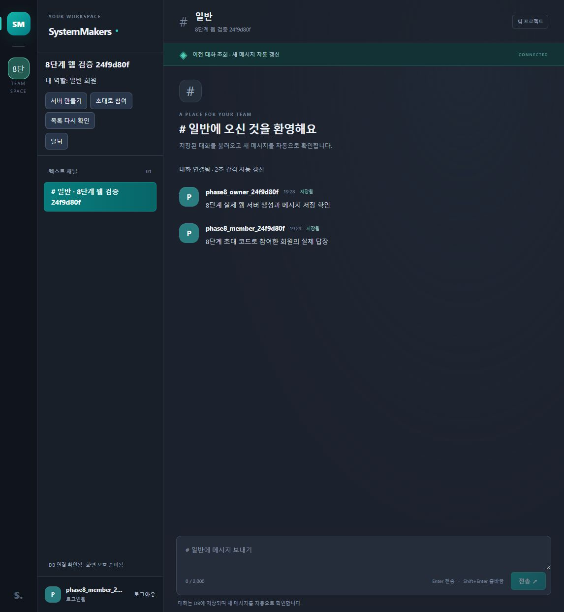
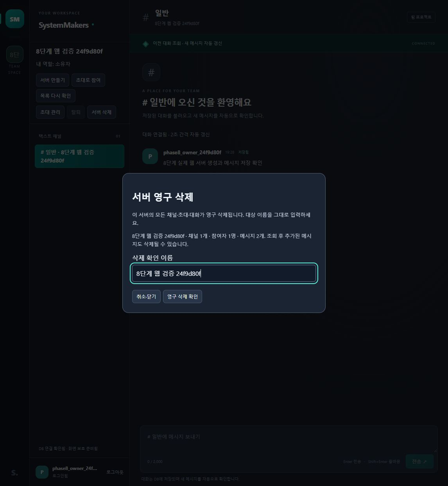

---
# 8단계 서버·초대·소속 검증 결과

검증일: 2026-10-21 · 시작 기준 1bb66b9 · 로컬 PHP 8.4.26·MySQL 8.4.13.

서버 목록·생성, 초대 상태·발급·폐기·참여, 탈퇴·삭제 미리보기·서버 삭제의 신규 API 9개와 실제 웹 화면을 연결했다. 채널 관리·프로필은 9~10단계로 남아 있다.

---
## 1. 구현과 자료 보존

- 기존 회원 인증·채널 조회·메시지 저장/이전 조회/2초 폴링 재사용. 내 서버 목록은 채널이 없는 서버도 반환.
- 서버·owner 소속·기본 일반 채널의 원자적 생성. 초대는 서버당 현재 상태 한 행, SHA-256 해시만 저장, 원문은 발급 응답에만 표시.
- 초대 24시간·재발급·폐기·중복 참여, 계정/IP별 독립 600초 제한과 Retry-After 구현.
- 일반 탈퇴의 메시지 보존, 소유자 탈퇴 차단, 삭제 영향·이름 확인·CASCADE 구현.
- 개발 DB 33360을 .runtime의 비공개 SQL에 백업한 뒤 CLI 변경 적용. 기존 계정 1·서버 1·채널 3·대화 3 유지, 테이블만 6→8.
- scripts/migrate.php·migrate.ps1과 변경 파일 001 제공. 기존/부분 적용 테이블이 있으면 재실행 거절. 변경 권한을 가진 계정의 환경 변수를 명시해 실행.
- 검사 DB 33361과 무작위 DB에서 공개 router.php·실제 가입·로그인·관리 API 검증. 인증 우회용 경로 없음.

---
## 2. 자동 검사

| 영역 | 결과 |
|---|---|
| node --test | 110개 통과, 실패·건너뜀 0개 |
| 기존 검사 | 기존 90개 유지 |
| 서버 관리 인수 | 상위 그룹 포함 12개, 실제 PHP·MySQL·공개 HTTP |
| ServerManager | 5개, 실제 상태 모듈과 네트워크·저장소 경계 |
| 관리 대화상자 | 3개, 실제 mountServerUI·ServerManager와 DOM 입출력 경계 |
| PHP 문법 | 36개 통과 |
| JavaScript 문법 | app.js·message-feed.mjs·server-manager.mjs·server-ui.mjs 4개 통과 |
| Git 공백 검사 | 통과 |

정상 흐름 외에 강제 DB 실패의 전체 롤백, 코드 교체·폐기·만료, 중복 참여의 admin 역할 보존, 소유자 탈퇴·타인 삭제 거절, 탈퇴 후 대화 유지, 계정/IP 제한·600초 창, 빈 서버 목록, 이름 불일치, CSRF·기대 계정, 삭제와 진행 중 전송의 잠금·CASCADE를 검사했다.

---
## 3. 독립 검토와 회귀 수정

독립 최종 검토의 5개 문제를 받아들여 수정하고 실패→통과 회귀를 확인했다. 추가 독립 재검토를 통과했다고 주장하지 않는다.

1. 이전 계정 요청의 늦은 인증 실패도 STALE_RESPONSE로 구분해 새 계정을 종료하지 않도록 수정.
2. 멤버십 잠금 대기 뒤 현재 DB 시각으로 초대 만료 검사. 실제 잠금 유지 검사에서 수정 전 200, 수정 후 INVALID_INVITE 확인.
3. 초대 재발급·폐기 시작 시 이전 원문 제거. 응답 유실 시 복사 차단과 초대 상태 별도 재조회.
4. 삭제 NAME_MISMATCH 후 최신 영향 재조회·확인 이름 초기화.
5. 삭제 이름 비교를 API와 같은 유니코드 구분 공백 정리로 변경. FEFF 포함 이름의 비활성 문제 수정.

추가 검사에서 코드 후보 조회 뒤 서버 삭제 경합의 404를 INVALID_INVITE 400으로 통일했다. 정규화 전 임의 1,000자 상한도 제거하여 JSON 크기 한도 안에서 정규화 후 1~100자를 판정한다. 각각 수정 전 실패를 확인했다.

---
## 4. 실제 웹 확인

1. 검증 전용 새 소유자 계정을 웹에서 가입·로그인, 서버·일반 채널 생성과 메시지 저장.
2. 소유자 탈퇴 비활성·초대 관리와 명시적 발급 확인 뒤 실제 64자리 코드 발급. 코드 원문은 공개 문서·이미지에서 제외.
3. 두 번째 새 계정도 웹에서 가입·로그인, 초대 코드로 참여·일반 회원 역할·기존 대화 조회·답장 저장.
4. 새로고침 뒤 두 대화 복원, 일반 회원 화면에서 소유자 관리 버튼 미표시.
5. 탈퇴 확인 뒤 서버·채널 0·대화 정리·입력 비활성. DB에서 작성 대화 2개 보존·해당 회원 소속 0개 확인.
6. 소유자 삭제 미리보기의 채널 1·회원 1·메시지 2 표시, 잘못된 이름 비활성·정확한 이름 활성·취소 시 유지 확인.
7. 별도 실제 소유자 HTTP 세션의 삭제 API로 이번 검증 서버만 정리. 두 검증 계정도 정확한 생성 사용자명으로 정리.
8. 기존 local_user 복원, 사용자 1·서버 1·채널 3·대화 3·검증 초대 0 보존 확인.

브라우저에서는 영구 삭제 최종 제출 대신 미리보기·확인 조건·취소를 확인했고 실제 삭제 커밋은 공개 API로 검증했다. 동시 접속 부하·실제 휴대폰·다른 브라우저의 전체 호환성은 이번 검사에 포함하지 않았다.

---
## 5. 남은 작업

- 9단계 채널 생성·이름 변경·삭제와 빈 서버의 관리자 생성 버튼.
- 10단계 본인 프로필 조회·사용자명 수정.
- 11단계 관리 기능 전체 연결과 실제 휴대폰·여러 브라우저 검증.
- 12단계 호스팅·HTTPS·프록시·백업 복구·부하 목표·오래된 제한 버킷 정리 스케줄.
