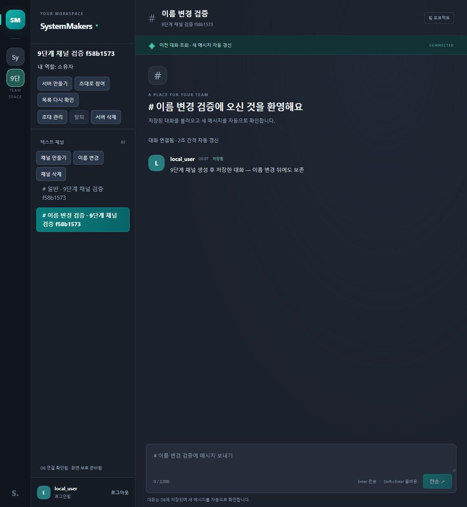
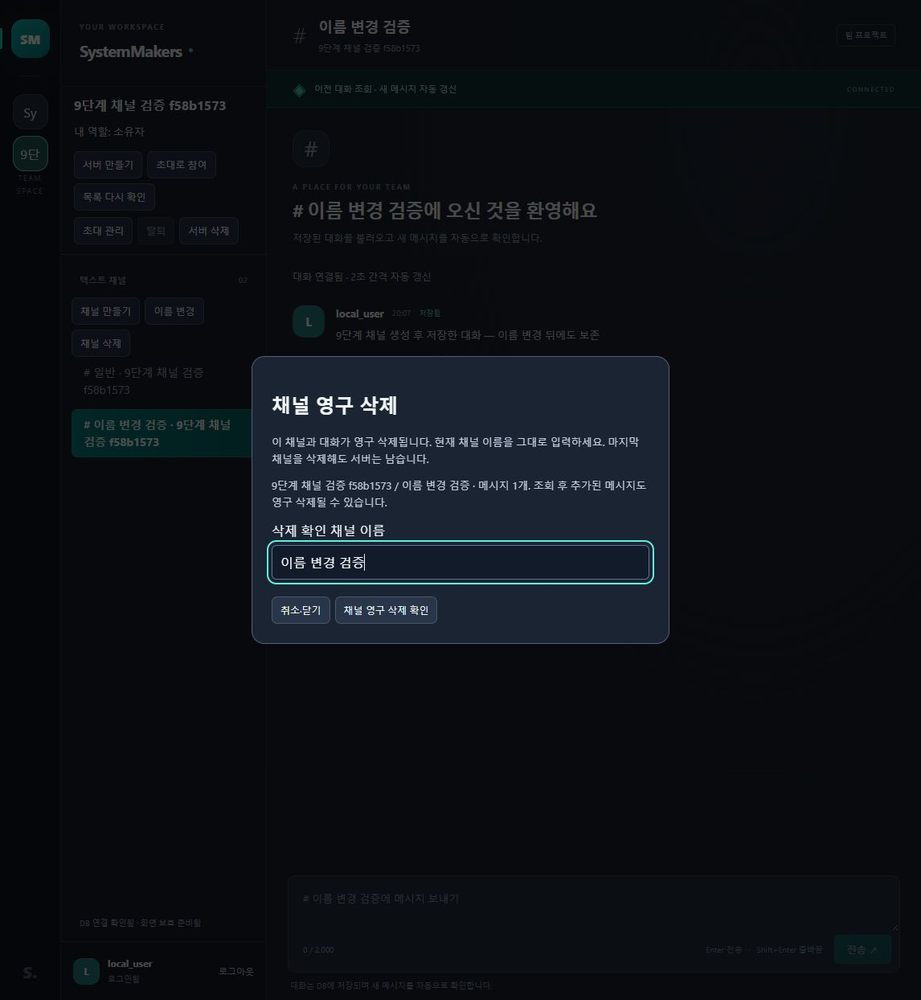
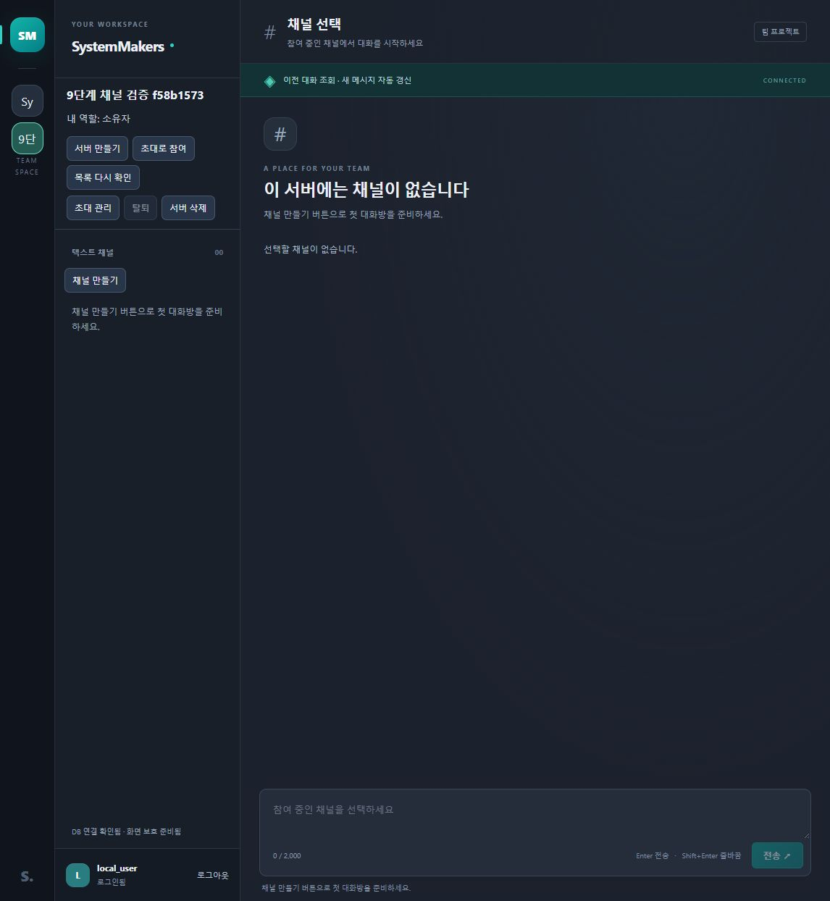

---
# 9단계 채널 관리 구현·검증 결과

검증일: 2026-10-21 · 작업 기준: main fdb47b4 · 계약: API 0.7 / DB 문서 0.4.

채널 생성·이름 변경·이름 확인 삭제와 빈 서버의 재생성을 구현했다. 공개 API 21개, 기존 8개 테이블을 사용하며 추가 마이그레이션은 없다. 검증 환경은 PHP 8.4.26·MySQL Community Server 8.4.13·실제 로컬 웹이다.

---
## 1. 구현 내용

- create_channel.php: 같은 서버 소유자·관리자만 생성, 정규화 후 1~100자, 서버별 중복 이름 거절, 새 채널 자동 선택.
- update_channel.php: 같은 권한으로 이름만 변경, ID·대화·소속 보존, 같은 이름 재저장도 200.
- delete_channel.php: 현재 이름의 정확한 확인, 해당 채널 메시지만 CASCADE 삭제. 마지막 채널 삭제 후 서버 유지.
- 서버→채널→멤버십 순서로 잠금, 최신 역할·소유자 불변식 재검사, 변경 실패 전체 롤백.
- 역할별 관리 버튼·삭제 영향·고정된 대상 ID·취소·이름 변경 경합 재확인, 계정 변경과 늦은 응답 보호.
- 삭제 성공은 후속 목록 조회 전에 해당 기록·초안·조회 예약·저장 선택 폐기. 목록 조회 실패에도 삭제 자료 복원 없음.
- 빈 서버는 관리자에게 채널 만들기 버튼과 생성 안내, 일반 회원에게 준비 대기 안내.

---
## 2. 자동 검사

| 항목 | 결과 |
|---|---|
| 전체 node --test | 130개 통과, 실패·건너뜀 0 |
| 기존 기준 | 8단계까지 110개 유지 |
| 채널 실제 API | 상위 그룹 포함 11개 |
| 채널 화면 | 실제 mountChannelUI·ServerManager 7개 |
| 앱 회귀 추가 | 빈 서버 전환과 삭제 후 목록 오류 2개 |
| PHP 문법 | 40개 통과 |
| JavaScript 문법 | 5개 통과 |
| Git 공백 검사 | 통과 |

API 검사는 33361 전용 MySQL의 무작위 DB에서 실제 PHP·공개 라우터·인증 세션을 사용했다. owner/admin 성공, member/미소속/교차 서버 거절, CSRF·기대 계정·입력·문자열 ID, 유니코드 공백, 대소문자 중복·다른 서버 동일 이름, 같은 이름 저장, 최신 역할 상실, 소유자 불일치, 부모 서버 동시 삭제, 진행 전송과 삭제, 마지막 채널·다른 자료 보존을 확인했다. 검사 후 해당 임시 DB만 정리했다.

---
## 3. 독립 검토와 수정

독립 코드 검토의 P2 두 건을 실제 실패 검사로 재현하고 수정했다.

1. 삭제 성공 후 목록 API가 500이면 이전 기록·초안·선택이 남는 문제: 성공 응답의 channel_id를 즉시 폐기하는 경계 추가. 이후 실패에도 기록 저장소·입력·영구 선택·예약이 남지 않는 검사 통과.
2. 부모 후보 조회가 만든 과거 스냅샷으로 소유자 불변식을 확인하는 문제: 변경 트랜잭션의 소유자 전체 조회에 FOR SHARE 적용. 잠금 대기 중 소유자 소속이 제거되면 500·이름 보존 확인.

추가로 부모 삭제 경합에서 SERVER_NOT_FOUND 대신 CHANNEL_NOT_FOUND를 유지하도록 수정하고 실패→통과를 확인했다. 마지막 채널 삭제 후 저장 선택 ID가 남는 문제도 같은 방식으로 수정했다. 독립 재검토는 추가 결함 없음, 관련 44개 통과를 보고했다. 이후 최종 전체 130개를 다시 실행했다.

---
## 4. 실제 웹 확인

기존 local_user로 이름이 고유한 별도 검증 서버 한 개를 만들어 확인했다. 원래 개발 서버·채널은 변경하지 않았다.

1. 웹에서 새 채널 생성과 자동 선택, 메시지 저장 성공.
2. 이름 변경 뒤 같은 메시지 표시, 새로고침 후 변경 이름·선택·DB 대화 복원.
3. 삭제 미리보기의 실제 메시지 1개 표시, 다른 이름 비활성·정확한 이름 활성, 취소 뒤 채널·대화 유지.
4. 별도 실제 소유자 HTTP 세션으로 검증 채널 삭제. 기존 화면은 다음 폴링에서 404를 확인하고 기록 제거·입력 차단. 목록 재조회 뒤 남은 일반 채널 선택.
5. 마지막 검증 채널도 공개 API로 삭제. 웹 목록 재조회·새로고침 후 서버 유지·채널 0·입력 비활성·관리자 생성 버튼 확인.
6. 빈 서버에서 웹 채널 재생성, 자동 선택·입력 복구.
7. 공개 API로 이번 검증 서버만 정리하고 원래 개발 서버 화면 복원. 실제 DB 사용자 1·서버 1·채널 3·대화 3·테이블 8개 보존 확인.

브라우저에서 영구 삭제 최종 버튼을 제출하지는 않았다. 미리보기·확인 조건·취소를 브라우저에서, 실제 삭제 커밋을 공개 HTTP API에서 각각 확인했다. 삭제 성공 뒤 통신 실패의 화면 상태는 실제 앱 코드 회귀로 검증했다. 운영 부하·실제 휴대폰·여러 브라우저 전체 호환성은 이번 결과에 포함하지 않는다.

---
## 5. 남은 단계

- 10단계: 본인 프로필 조회·사용자명 수정과 기존 작성자 관계 보존.
- 11단계: 가입부터 서버·채널·프로필·대화·탈퇴까지 전체 연결, 실제 기기·여러 브라우저 확인.
- 12단계: 운영 호스팅·HTTPS·프록시·백업 복원·부하 목표·제한 버킷 정리 스케줄.
