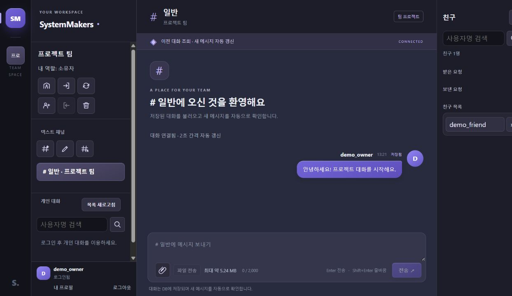
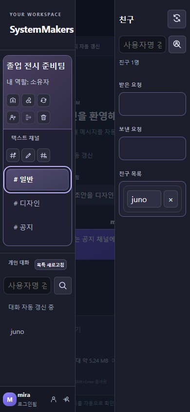

---
# SystemMakers 화면 기획서

아래 이미지는 2026년 11월 19일 테마 변경 전에 촬영한 기능 예시다. 예시 계정 두 개로 같은 서버의 채널 대화와 두 사람의 개인 대화를 열었다. [전체 화면 16장과 설명](../README.md#화면-살펴보기) · [이미지 ZIP](assets/ui/systemmakers-ui-screenshots.zip)

---
## 팀 채팅과 개인 대화

초대로 ‘졸업 전시 준비팀’에 들어오면 왼쪽 서버 카드 아래에 일반·디자인·공지 채널이 보인다. 채널을 누르면 가운데 제목과 대화 내역이 함께 바뀐다. 새로 참여한 팀원도 선택한 채널의 이전 대화를 읽을 수 있다.

| 화면 영역 | 사용자가 보는 내용 | 디자인 수정 위치 |
|---|---|---|
| 왼쪽 서버 선택과 채널 목록 | 서버 이름 배너 아래에 소속 채널을 묶는다. 소유자와 관리자는 채널을 만들거나 관리할 수 있다. | [화면 구조](../index.html), [채팅 스타일](../frontend/chatting.css), [서버 표시](../frontend/server-ui.mjs), [채널 관리](../frontend/channel-ui.mjs) |
| 가운데 대화 | 본인 메시지는 오른쪽의 보라색 말풍선, 상대방 메시지는 왼쪽에 표시한다. 입력란 아래 클립으로 파일을 고르고 ×로 선택을 취소한다. | [채널 대화](../frontend/app.js), [개인 대화](../frontend/direct-ui.mjs), [파일 선택](../frontend/attachments-ui.mjs) |
| 왼쪽의 사람 아이콘 | 서버 아이콘 목록 상단에서 개인 대화 목록을 연다. 읽지 않은 대화가 있으면 사람 아이콘과 해당 대화에 느낌표가 표시된다. | [개인 대화](../frontend/direct-ui.mjs), [화면 구조](../index.html) |
| 오른쪽 친구 패널 | 수락된 친구 이름이 위에서부터 표시된다. 종 아이콘을 누르면 받은 요청과 보낸 요청이 열리고, 각 제목 오른쪽의 정사각형 아이콘으로 ‘모두 수락’과 ‘상태 확인’을 실행한다. 친구 이름을 누르면 개인 대화가 열린다. | [친구 목록](../frontend/friends-ui.mjs), [채팅 스타일](../frontend/chatting.css) |
| 왼쪽 하단 계정 | 상단 제목과 하단 계정 영역은 목록을 스크롤해도 자리를 유지한다. 하단 아이콘으로 내 프로필을 열거나 로그아웃한다. | [화면 구조](../index.html), [프로필](../frontend/profile-ui.mjs) |

개인 대화는 상대방과 둘이서 나누는 대화다. 왼쪽의 개인 대화 목록이나 오른쪽의 친구 이름으로 연다. 개인 대화에서 서버 채널로 돌아가도 각 대화의 기록은 따로 남는다. [개인 대화 화면](assets/ui/current-direct.jpg)

---
## 로그인과 프로필

- 게스트는 왼쪽 하단 로그인 아이콘으로 이메일·비밀번호 입력 창을 연다. 회원가입 화면에서는 사용자명·이메일·8~64자 비밀번호를 입력한다. 가입 후 로그인해야 메시지를 쓸 수 있다. [로그인](assets/ui/current-login.jpg) · [회원가입](assets/ui/current-register.jpg)
- 내 프로필을 열면 이메일과 가입일 옆에 저장된 값이 보인다. 사용자명은 입력란 오른쪽에서 저장한다. 상태 메시지와 사진도 각 저장 버튼으로 반영한다. 저장하기 전에 창을 닫으면 다음에 열 때 마지막으로 저장한 값이 보인다. [내 프로필](assets/ui/current-profile.jpg) · [상태·사진·차단 설정](assets/ui/current-profile-settings.jpg)
- 서버나 채널을 삭제할 때는 대상과 영향을 확인한 뒤 ‘네’ 또는 ‘아니오’를 선택한다. [서버 삭제 확인](assets/ui/current-server-delete.jpg) · [채널 삭제 확인](assets/ui/current-channel-delete.jpg)

---
## 좁은 화면에서 목록 열기

화면 너비가 1050px 이하이면 ‘친구’ 버튼이 오른쪽 친구 목록을 연다. 650px 이하이면 ☰ 버튼이 서버 막대 옆의 채널 목록을 연다. 채널 대화와 개인 대화 모두 목록 밖을 누르거나 Esc 키로 닫을 수 있다. 아래 이미지는 변경 전 390 × 844 화면이다.

---
## 색상과 조작 기준

- 공통 색상과 글꼴, 입력 요소, 인증 창의 공통 배치를 수정한다. 채팅은 다크 네이비 바탕에 밝은 푸른색 경계선을 사용한다. [공통 스타일](../frontend/app.css)
- 서버·채널·친구 목록과 모바일 메뉴, 말풍선과 메시지 입력란을 수정한다. [채팅 스타일](../frontend/chatting.css)
- 로그인과 회원가입은 같은 대화상자를 쓴다. 각 파일은 해당 모드에서만 적용되며 창, 입력란, 제출 버튼을 따로 수정할 수 있다. [로그인](../frontend/login.css) · [회원가입](../frontend/Sign%20up.css)
- 게스트는 실행 중인 사이트 주소 끝에 `#login-window` 또는 `#signup-window`를 붙여 해당 창을 바로 열 수 있다. 두 창은 최대 480px 너비의 카드로 표시되며 작은 화면에서는 카드 안을 세로로 스크롤한다.
- 하단 계정 영역, 로그인·로그아웃 아이콘, 내 프로필 카드를 수정한다. [계정 스타일](../frontend/logout.css)
- 아이콘 버튼은 로그인·로그아웃, 초대, 검색처럼 용도별 모양을 갖는다. 아이콘을 바꿀 때 키보드 초점과 접근성 이름도 유지한다.
- 화면 구조를 바꿀 때 자바스크립트가 요소를 찾는 `id`와 입력 레이블의 `for` 연결을 보존한다. [화면 구조](../index.html)
- 채널·개인 대화 입력에서 Enter는 전송, Shift+Enter는 줄바꿈이다. 한글 조합이 끝날 때 누르는 Enter는 글자 조합에 사용한다. 두 화면 상단의 제목과 탐색 버튼 배치를 동일하게 유지한다.
