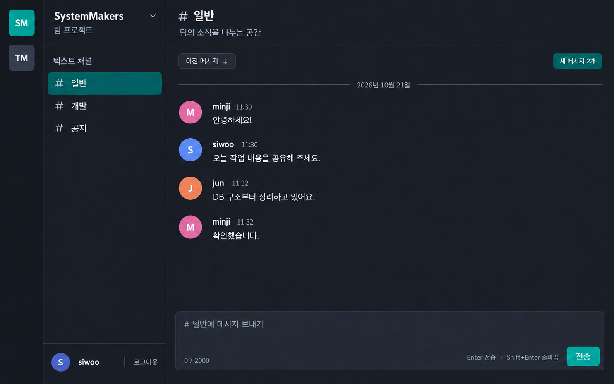
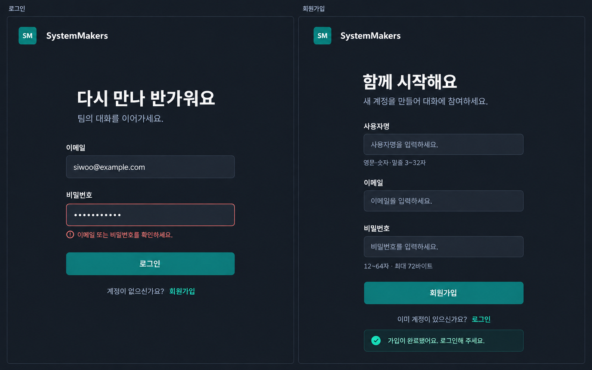

---
# SystemMakers 메신저 UI 시안

작성일: 2026-10-21. 팀원 A가 회원 인증과 채널별 채팅을 구현할 때 사용할 이미지 시안이다. 현재 산출물은 PNG이며 실제 HTML·CSS·JavaScript 화면은 다음 단계다.

---
## 채팅 화면

서버 선택 영역, 채널 목록, 대화 영역의 3열 구성이다. Discord의 서버·채널 계층과 Slack의 시간순 대화 구성을 참고하고 SystemMakers 이름·색상·문구로 제작했다. [Discord 공식 안내](https://support.discord.com/hc/en-us/articles/360045138571-Beginner-s-Guide-to-Discord), [Slack 채널 안내](https://slack.com/features/channels)

| 화면 요소 | 연동 대상 | 구현 기준 |
|---|---|---|
| 사용자명·로그아웃 | get_current_user.php, logout.php | 로그인 세션 기준 사용자 표시 |
| 서버·채널 선택 | C의 서버·채널 목록 API | C 기능 전에는 개발용 채널 ID 선택으로 대체 |
| 대화 목록 | get_messages.php | 사용자명·본문·현지 시각 표시, ID 중복 제거 |
| 이전 메시지 | get_messages.php의 before_id | 위쪽에 이전 결과 추가, 신규 폴링 커서는 유지 |
| 새 메시지 안내 | get_messages.php의 after_id | 현재 화면 아래에 추가된 메시지를 클라이언트에서 집계 |
| 메시지 입력·전송 | send_message.php | 원문 2,000자 제한, Enter 전송·Shift+Enter 개행 |

이니셜 아바타는 username에서 화면이 만드는 장식이며 DB에 아바타 이미지를 저장하는 기능이 아니다. 새 메시지 숫자는 현재 화면의 클라이언트 상태이며 서버의 영구 읽음 기록이나 실시간 접속 상태를 의미하지 않는다. 자동 스크롤은 사용자가 대화 맨 아래를 보고 있을 때만 적용한다.

음성·영상 통화, 첨부 파일, 메시지 검색, DM, 반응, 접속자 목록은 이번 시안에서 제외했다. 채널 생성 버튼도 제거하여 C의 관리 기능과 화면 범위를 구분했다.

---
## 로그인과 회원가입

왼쪽은 이메일·비밀번호 로그인과 로그인 실패 안내, 오른쪽은 사용자명·이메일·비밀번호 가입과 가입 성공 안내의 예시다. 나란한 두 패널은 비교용 디자인 보드이며 실제 화면에서는 로그인과 가입 중 하나를 표시한다. 오류와 성공 문구는 각 상태의 예시다.

초기 CSRF 발급 → 회원가입 또는 로그인 → 로그인 성공 후 새 CSRF 토큰 저장 → 채팅 화면 진입 순서를 따른다. 회원가입만으로 로그인이나 서버 가입이 완료되지 않는다. 가입 성공 문구를 표시한 뒤 로그인으로 이동한다.

사용자명은 영문·숫자·밑줄 3~32자이며, 비밀번호는 12~64 코드 포인트와 UTF-8 72바이트 상한을 함께 검사한다. 상세 규칙은 [API.md](API.md)를 따른다. 소셜 로그인·비밀번호 재설정 등 계약에 없는 버튼은 표시하지 않는다.

---
## 공통 화면 기준

- 짙은 남색·회색 바탕에 청록색 선택·전송 버튼을 사용하고 메시지 본문을 가장 읽기 쉽게 배치.
- 입력 필드에 항상 별도 레이블을 표시하고 오류를 색상과 문구로 함께 표시.
- 키보드 포커스와 버튼의 로딩·비활성 상태는 실제 프론트 구현 시 추가.
- 메시지는 textContent로 렌더링하고 SQL·세션 ID·CSRF 토큰·API 경로 같은 내부 정보는 화면에 표시하지 않음.
- 모바일에서는 서버·채널 목록을 접어 대화 영역을 우선 표시. 모바일 시안 이미지는 이번 범위에 포함하지 않음.

이미지는 기본 image_gen 도구로 제작했다. 원본 생성과 최종 수정에 사용한 프롬프트는 [UI-PROMPTS.md](UI-PROMPTS.md)에 기록했다. 최종 파일은 docs/assets/ui/chat-desktop-v1.png와 docs/assets/ui/auth-desktop-v1.png다.

---
## 검색 참고

- [Discord 서버와 텍스트 채널 안내](https://support.discord.com/hc/en-us/articles/360045138571-Beginner-s-Guide-to-Discord)
- [Slack 채널형 대화 안내](https://slack.com/features/channels)
